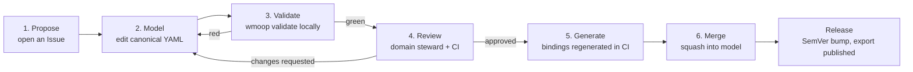

# Contributing to WMOOP

> **WMOOP — World Map Object-Oriented Programming**
> *Describe World into OOP. Map all World Objects into Programming Languages.*

Welcome. WMOOP is a collaborative, open-source effort to model the real world — biology, mathematics, music, astronomy, geography, transport, language, and beyond — as a **single, language-neutral, object-oriented knowledge model** from which idiomatic code is generated in many languages (C#, Java, Python, C++, JavaScript) and a database schema. This guide tells you how to contribute so that your work is correct, reusable, and automatically verifiable.

If you only remember one sentence, remember this:

> **You contribute by editing the canonical declarative model. You never hand-write C#, Java, Python, or C++ classes. Bindings are *generated* from the model; writing them by hand is the one thing this project does not accept.**

---

## 1. The one rule, and why it exists

The model is written **once**, declaratively, in a language-neutral form. Every per-language repository (`wmoop.net`, `wmoop.java`, `wmoop.py`, `wmoop.cpp`, `wmoop.js`) and the database (`wmoop.db`) is **produced by a code generator** and verified against the canonical model by a **conformance test suite**. "Write once, replicate everywhere" is therefore *mechanical*, not manual.

This is what lets:

- a professor assign a student the **Geography** domain and have that student's work instantly become correct C#, Java, Python, C++ and SQL;
- an AI agent contribute safely, because its output is a small, slot-shaped, machine-checkable artifact rather than free-form code in five languages;
- the project scale to "the whole world" without the conceptual model ever being duplicated or drifting between languages.

If you edit a generated file by hand, CI will detect the drift and reject it (see [§9](#9-ci-gates)).

---

## 2. Core principles you must respect

These are the project's load-bearing invariants. Every contribution is judged against them.

| # | Principle | What it means for you |
|---|-----------|------------------------|
| **I1** | **Schema-first / ontology-first.** | The canonical, language-neutral **World Model (WM)** is the single source of truth. You edit *it*. |
| **I2** | **Three layers.** | **L0** meta-model (small, fixed upper ontology), **L1** domain models (classes, properties, relations, roles), **L2** instances (optional reference data, e.g. the planets). Know which layer you are touching. |
| **I3** | **Composition, interfaces/traits, and ROLES over deep inheritance.** | Inheritance models genuine, stable *is-a-kind-of* essence only, and stays shallow (Liskov-respecting). Cross-cutting or cross-domain facets (a Person *as* a Driver) are **roles attached by composition** — never `Driver : Person`. |
| **I4** | **Every concept is self-describing and sourced.** | Stable global ID, human name, definition, provenance/citation, and (for quantities) units — on **every** node. Facts are sourced. |
| **I5** | **Versioned, acyclic modules.** | Domains are versioned modules with an explicit **acyclic** dependency graph. Cross-domain links are declared and versioned. |
| **I6** | **Everything is machine-checkable.** | A clear, automated **Definition of Done** means humans *and* AI can contribute safely. If CI is green and a reviewer approves, it is correct-by-construction. |

---

## 3. Repository map — where things live

WMOOP is split across the `WMOOP` GitHub organization. Know which repo your change belongs in.

| Repo | Role | Do you hand-edit it? |
|------|------|----------------------|
| **`wmoop.doc`** | Canonical model source (`/model/**`, authored in YAML) **and** all governance/spec docs (this file, the meta-model spec, ethics, ADRs). | **Yes — this is where you contribute the model.** |
| **`wmoop.json`** | The **JSON Schema meta-schema** that validates the model, plus the **compiled JSON / JSON-LD export** of the whole World Model (a build artifact other repos consume). | Meta-schema: by proposal/ADR only. Compiled export: **never** — it is generated. |
| **`wmoop.net`** (C#), **`wmoop.java`**, **`wmoop.py`**, **`wmoop.cpp`**, **`wmoop.js`** | **Generated** idiomatic bindings + per-language conformance tests + the generator templates. | Model classes: **never**. Generator *templates* and runtime glue: yes, via their own PRs. |
| **`wmoop.db`** | **Generated** database schema/migrations from the model. | Schema: **never**. Migration tooling: yes. |

> The canonical **source** lives in `wmoop.doc/model/**`. The **machine contract** (JSON Schema) and the **compiled graph** live in `wmoop.json`. Treat them as two faces of the same canonical layer.
>
> *(The exact repo-to-artifact split is fixed by [ADR-0001]; if you think it should change, open an ADR, don't improvise.)*

### Canonical model layout (`wmoop.doc/model/`)

```
model/
  _meta/                      # L0 — upper ontology (frozen; maintainers only)
    Thing.yaml
    Quantity.yaml
    relations.yaml
    units.yaml
  nature/                     # L1 — a domain module
    domain.yaml               #   domain manifest: id, version, dependsOn, stewards
    animals/
      Animal.yaml
      Mammal.yaml
      ...
    plants/
    geography/
    people/
      Person.yaml
  transport/
    domain.yaml
    Vehicle.yaml
    AutoVehicle.yaml
    Moped.yaml
    roles/
      Driver.yaml             # cross-domain role (depends on nature.people)
  space/
    domain.yaml
    planets/
      Planet.yaml
      instances/
        Mars.yaml             # L2 — reference instance
  _crosslinks/                # cross-domain links & role bindings
    transport--nature.yaml
```

**One concept per file.** This keeps diffs small, reviews fast, blame meaningful, and PRs atomic — which matters for humans and is essential for AI (see `AI_CONTRIBUTING.md`).

---

## 4. Identifiers, naming, and required fields

### 4.1 The ID scheme (CURIE)

Every node has a **stable global ID** shaped as a CURIE:

```
wm:<domain>[.<subdomain>...].<LocalName>
```

| Node kind | Segment | Case of LocalName | Example |
|-----------|---------|-------------------|---------|
| Domain | — | lowercase | `wm:nature` |
| Class (concept) | — | `PascalCase` | `wm:nature.animals.Mammal` |
| Property | `prop.` | `camelCase` | `wm:nature.animals.prop.legCount` |
| Relation | `rel.` | `camelCase` | `wm:core.rel.partOf` |
| Role | `role.` | `PascalCase` | `wm:transport.role.Driver` |
| Instance (L2) | `ind.` | `PascalCase`/stable | `wm:space.planets.ind.Mars` |

Rules:

- **IDs are immutable once merged.** You never rename an ID. To rename the *human* name, change `name`; to retire an ID, deprecate it and add an `alias`/`replacedBy`. (CI enforces this via the no-mutation gate.)
- IDs are globally unique. Properties and relations are **first-class and reusable** — define `legCount` once, reference it from many classes.
- Top-level domain prefixes come from a **reserved registry** (`model/_meta/domains.yaml`); adding a top-level domain requires maintainer sign-off (see the *add a domain* template).

### 4.2 Required fields on every node (I4)

No node merges without all of these:

- `id` — the CURIE above.
- `name` — human-readable name (and `altNames` / localized `names` where useful).
- `definition` — one or two precise sentences. Not a tautology; not a synonym.
- `layer` — `L0` | `L1` | `L2`.
- `status` — `proposed` | `reviewed` | `stable` | `deprecated`.
- `provenance` — at least one `source`, **or** `kind: definitional` (a project-chosen convention/definition) **or** `kind: convention`. Factual claims (measured quantities, taxonomic facts) **must** be `kind: sourced`.
- For **quantity** properties: `unit` (UCUM code), `dimension`, and `datatype`.

---

## 5. The contribution lifecycle



### Step 1 — Propose (open an Issue)

Before you model, **open an issue** using the matching template (*New concept*, *New domain*, *New cross-domain link*, *New reference data*, *Correction*). This gives stewards a chance to point you at an existing concept, reserve an ID prefix, and prevent duplicate work. Small corrections to an existing node may skip straight to a PR.

> "Complete my domain" or "import this dataset" is a *proposal*, not a mandate. State sources and scope in the issue; the side-effectful parts (new IDs, new dependencies, bulk instances) get discussed first.

### Step 2 — Model (edit the canonical model)

Fork, branch (`feat/nature.animals.cetaceans`, `fix/transport.Moped-wheels`), and edit YAML under `wmoop.doc/model/**` using the [templates in §7](#7-fill-in-templates). **You do not touch any language repo.**

### Step 3 — Validate (run the oracle locally)

Install the toolkit and run:

```bash
wmoop validate          # schema + referential integrity + all gates
wmoop lint              # naming, style, Liskov/roles heuristics
wmoop conformance       # generate bindings in-memory + run conformance suite
```

Fix every error before you push. These are the **same checks CI runs** — CI is just the referee, not a different exam. (If `wmoop` is unavailable to you, CI will still run them, but you'll iterate slower.)

### Step 4 — Review

Open a PR. The relevant **domain steward** (via `CODEOWNERS`) reviews for conceptual correctness, sourcing, and modeling soundness that a machine can only partly judge (is this *really* a kind-of? is the definition right? is the source authoritative?). CI must be green for a human to even start.

### Step 5 — Generate bindings

On approval, CI regenerates the bindings for every language and the DB, and runs each repo's conformance suite. **You do nothing here** — this is the payoff of schema-first. If generation or conformance fails, the problem is in the model (or the generator); the PR goes back.

### Step 6 — Merge & release

Maintainers squash-merge. A release bumps the affected domain's SemVer, publishes the recompiled JSON/JSON-LD export from `wmoop.json`, and the language repos pick up the new model version.

---

## 6. Modeling decision rules

Getting the *shape* right matters more than getting lots of nodes in. Use these rules; reviewers and the Liskov/roles lint ([§9](#9-ci-gates)) enforce them.

### 6.1 Inheritance vs. role vs. composition vs. category

Ask, in order:

1. **Is it a genuine, permanent *kind-of* that would satisfy Liskov** (anything true of the parent is true of the child, with no exceptions and no narrowing that breaks callers)? → use **inheritance** (`kindOf`). Keep it **shallow** (soft cap: 5 levels; deeper needs justification).
2. **Is it a facet a thing *plays* or *has*, possibly temporarily, possibly across domains** (a Person *as* a Driver; a Person *as* an Employee)? → use a **role** attached by composition. **Never** `Driver : Person`.
3. **Is it a part/whole, membership, or other association?** → use a **relation** (`partOf`, `memberOf`, `locatedIn`).
4. **Is it a contested or multi-parent classification** (a tomato as fruit vs. vegetable; a whale's folk-vs-scientific grouping)? → use **categories/tags** and/or multiple `classifiedAs` relations with provenance, **not** a forced single inheritance tree. Mark `disputed: true` with sources on each side.

> **Worked example (the founder's case).** A `Person` is modeled in `nature.people`. A `Driver` is **not** a subclass of Person. `Driver` is a **role** (`wm:transport.role.Driver`) with `appliesTo: wm:nature.people.Person`, adding meta such as `drivingLicence` and `licenceCategory`. The same Person can also play `wm:company.role.Employee`. This is composition, and it keeps the two domains independent and acyclic. See the [cross-domain role template](#74-add-a-cross-domain-link--role).
>
> *(Humans as a biological kind are handled separately: `wm:nature.people.Person` carries a `classifiedAs` relation to the zoological concept — multiple classification by relation, not by cramming biology and personhood into one inheritance chain.)*

### 6.2 Liskov checklist (for every `kindOf`)

- The child does **not** remove or make-optional a required parent property.
- The child does **not** narrow a property's type incompatibly, or widen a relation beyond the parent's contract.
- The child does **not** contradict the parent's definition.
- Every instance of the child is, without caveat, an instance of the parent.

If any fails, it's a role, a relation, or a sibling — not a subclass.

---

## 7. Fill-in templates

Copy the template, fill every required field, delete the guidance comments. Each template has a blank form and a worked example. Required fields are marked `# REQUIRED`.

### 7.1 Add a class (concept)

**When:** a new *kind of thing* that satisfies the kind-of / Liskov test.

```yaml
# model/<domain>/<Local>.yaml
id: wm:<domain>.<Local>            # REQUIRED  PascalCase local name
name: <Human Name>                 # REQUIRED
names:                             # optional localized names
  ro: <Nume>
layer: L1                          # REQUIRED
status: proposed                   # REQUIRED  proposed|reviewed|stable|deprecated
definition: >                      # REQUIRED  precise, non-tautological
  <one or two sentences>
kindOf: wm:<domain>.<Parent>       # REQUIRED unless this is a domain root; single parent only
abstract: true|false               # is this directly instantiable?
properties:                        # property references (define properties separately, §7.2)
  - ref: wm:<domain>.prop.<name>   #   reference a first-class property
    required: true
    default: <value>               #   optional
    override:                      #   optional, Liskov-safe constraint tightening only
      min: 0
implements:                        # optional interfaces/traits
  - wm:core.trait.<Trait>
categories: [<tag>, ...]           # optional non-inheritance classification
provenance:                        # REQUIRED
  kind: sourced                    #   sourced | definitional | convention
  sources:
    - type: book                   #   book|paper|standard|dataset|url
      title: <Title>
      author: <Author>
      year: <YYYY>
      locator: <page/section/DOI/ISBN>
      url: <optional>
      retrieved: <YYYY-MM-DD>
contributedBy:                     # REQUIRED  (see AI_CONTRIBUTING.md for agents)
  human: <github-handle>
```

**Worked example:**

```yaml
# model/nature/animals/Mammal.yaml
id: wm:nature.animals.Mammal
name: Mammal
names: { ro: Mamifer, la: Mammalia }
layer: L1
status: proposed
definition: >
  A vertebrate animal of the class Mammalia, distinguished by mammary glands
  that in females produce milk, hair or fur, and (typically) live birth.
kindOf: wm:nature.animals.Vertebrate
abstract: true
properties:
  - { ref: wm:nature.animals.prop.legCount, required: true, default: 4 }
  - { ref: wm:nature.animals.prop.isWarmBlooded, required: true, default: true }
  - { ref: wm:nature.animals.prop.hasMammaryGlands, required: true, default: true }
categories: [vertebrate, tetrapod]
provenance:
  kind: sourced
  sources:
    - type: book
      title: "Campbell Biology"
      author: "Urry, L. et al."
      year: 2021
      locator: "Ch. 34, Mammalia"
      retrieved: 2026-10-16
contributedBy: { human: your-handle }
```

**Common mistakes:** parent is not a true kind-of (should be a role/relation); definition restates the name; quantity property with no unit; no source for a factual claim.

### 7.2 Add a property

**When:** a reusable attribute. Define it once as first-class; reference it from many classes.

```yaml
# model/<domain>/properties.yaml  (or one file per property)
id: wm:<domain>.prop.<name>        # REQUIRED  camelCase
name: <Human Name>                 # REQUIRED
layer: L1                          # REQUIRED
status: proposed                   # REQUIRED
definition: >                      # REQUIRED
  <what this property means>
datatype: integer|decimal|string|boolean|enum|date|reference  # REQUIRED
# --- for quantities only, ALL REQUIRED: ---
quantityKind: <e.g. Length, Mass, Count>
unit: <UCUM code, e.g. kg, km, 1>
dimension: <e.g. M, L, 1>
# --- for enums: ---
enumValues: [<v1>, <v2>]
# --- constraints (optional): ---
constraints: { min: 0, max: null }
cardinality: single|multi
provenance:                        # REQUIRED
  kind: convention                 #   units/definitions are often conventions
contributedBy: { human: <handle> }
```

**Worked example:**

```yaml
id: wm:nature.animals.prop.legCount
name: Leg count
names: { ro: Numărul de picioare }
layer: L1
status: proposed
definition: The number of legs an organism has in its typical adult form.
datatype: integer
quantityKind: Count
unit: "1"            # UCUM dimensionless count
dimension: "1"
constraints: { min: 0 }
cardinality: single
provenance: { kind: convention }
contributedBy: { human: your-handle }
```

### 7.3 Add a domain

**When:** a whole new top-level subject (requires an issue + maintainer sign-off for the reserved prefix).

```yaml
# model/<domain>/domain.yaml
id: wm:<domain>                    # REQUIRED  lowercase, from the reserved registry
name: <Domain Name>               # REQUIRED
layer: L1                          # REQUIRED
version: 0.1.0                      # REQUIRED  SemVer
status: proposed                   # REQUIRED
definition: >                      # REQUIRED  scope of the domain
  <what this domain covers and, importantly, what it does NOT>
dependsOn: []                      # REQUIRED  other domains; MUST stay acyclic (I5)
roots:                             # REQUIRED  top abstract concept(s)
  - wm:<domain>.<Root>
stewards: [<handle>, ...]          # REQUIRED  owners for CODEOWNERS
provenance:                        # REQUIRED  authoritative references for the field
  kind: sourced
  sources: [ ... ]
contributedBy: { human: <handle> }
```

**Worked example:**

```yaml
# model/transport/domain.yaml
id: wm:transport
name: Transport
layer: L1
version: 0.1.0
status: proposed
definition: >
  Human-made conveyances and the concepts of moving people and goods.
  Covers vehicles and transport roles; does NOT cover roads/geography
  (see wm:nature.geography) or legal persons (see wm:nature.people).
dependsOn: [wm:nature]            # for the Person a Driver role applies to
roots: [wm:transport.Vehicle]
stewards: [your-handle]
provenance:
  kind: definitional
contributedBy: { human: your-handle }
```

With `Vehicle → AutoVehicle → Moped` each added via the [class template](#71-add-a-class-concept) (`numberOfWheels` as a `prop`, Moped overriding its default to 2).

### 7.4 Add a cross-domain link / role

**When:** a facet one domain attaches to a concept in another (the Person-as-Driver case). This is **composition**, declared in `_crosslinks/`.

```yaml
# model/<domain>/roles/<Role>.yaml
id: wm:<domain>.role.<Role>        # REQUIRED  PascalCase
name: <Role Name>                  # REQUIRED
layer: L1                          # REQUIRED
status: proposed                   # REQUIRED
definition: >                      # REQUIRED
  <the capacity/capability this role confers>
appliesTo:                         # REQUIRED  the host concept(s), in another domain
  - wm:<otherdomain>.<Host>
addsProperties:                    # properties the role contributes
  - ref: wm:<domain>.prop.<name>
    required: true
addsRelations: [ ... ]             # optional
constraints: >                     # optional role-entry conditions
  <e.g. host must have prop.age >= legal minimum>
provenance: { kind: sourced, sources: [ ... ] }  # REQUIRED
contributedBy: { human: <handle> }
```

**Worked example (the founder's case):**

```yaml
# model/transport/roles/Driver.yaml
id: wm:transport.role.Driver
name: Driver
names: { ro: Șofer }
layer: L1
status: proposed
definition: >
  A role played by a person who is licensed and operating a vehicle.
  Driver is NOT a subtype of Person; it is a capacity a Person plays.
appliesTo: [wm:nature.people.Person]
addsProperties:
  - { ref: wm:transport.prop.drivingLicenceNumber, required: true }
  - { ref: wm:transport.prop.licenceCategory,     required: true }
  - { ref: wm:transport.prop.licenceExpiry,        required: false }
addsRelations:
  - { rel: wm:transport.rel.operates, target: wm:transport.Vehicle }
constraints: "host must satisfy the licensing-age rule of the applicable jurisdiction"
provenance:
  kind: sourced
  sources:
    - { type: standard, title: "Vienna Convention on Road Traffic", year: 1968, locator: "Art. 41" }
contributedBy: { human: your-handle }
```

**Common mistakes:** writing `kindOf: wm:nature.people.Person` (the lint will reject it); creating a dependency cycle between the two domains; forgetting that the role, not Person, owns the licence properties.

### 7.5 Add reference instances (L2)

**When:** real individuals worth shipping as reference data (the planets, chemical elements, countries). Keep instances sourced and separate from the classes.

```yaml
# model/<domain>/<group>/instances/<Name>.yaml
id: wm:<domain>.<group>.ind.<Name> # REQUIRED  ind. segment
name: <Human Name>                 # REQUIRED
layer: L2                          # REQUIRED
status: proposed                   # REQUIRED
instanceOf: wm:<domain>.<Class>    # REQUIRED  the class it instantiates
values:                            # property values, each with its own source if factual
  - ref: wm:<domain>.prop.<name>
    value: <value>
    unit: <UCUM if quantity>
    source: { type: dataset, title: ..., url: ..., retrieved: <YYYY-MM-DD> }
provenance: { kind: sourced, sources: [ ... ]}   # REQUIRED
contributedBy: { human: <handle> }
```

**Worked example:**

```yaml
# model/space/planets/instances/Mars.yaml
id: wm:space.planets.ind.Mars
name: Mars
names: { ro: Marte }
layer: L2
status: proposed
instanceOf: wm:space.planets.Planet
values:
  - ref: wm:space.planets.prop.mass
    value: 6.417e23
    unit: kg
    source: { type: dataset, title: "NASA Mars Fact Sheet", url: "https://nssdc.gsfc.nasa.gov/planetary/factsheet/marsfact.html", retrieved: 2026-10-16 }
  - ref: wm:space.planets.prop.equatorialRadius
    value: 3396.2
    unit: km
    source: { type: dataset, title: "NASA Mars Fact Sheet", url: "https://nssdc.gsfc.nasa.gov/planetary/factsheet/marsfact.html", retrieved: 2026-10-16 }
provenance:
  kind: sourced
  sources:
    - { type: dataset, title: "NASA Planetary Fact Sheet", url: "https://nssdc.gsfc.nasa.gov/planetary/factsheet/", retrieved: 2026-10-16 }
contributedBy: { human: your-handle }
```

---

## 8. Definition of Done (machine-checkable)

A contribution is **Done** when **all** of the following are true. Every item is checked automatically — there is no subjective "looks good enough."

- [ ] **Validates:** `wmoop validate` passes (schema + referential integrity).
- [ ] **Lints:** `wmoop lint` passes (naming, style, Liskov/roles heuristics).
- [ ] **Required fields:** every touched node has `id`, `name`, `definition`, `layer`, `status`, `provenance` (and `unit`/`dimension`/`datatype` for quantities).
- [ ] **Sourced:** every factual claim has `kind: sourced` with a resolvable citation; definitions/conventions are explicitly marked as such.
- [ ] **IDs:** unique, correctly shaped, immutable (no existing ID was renamed/mutated).
- [ ] **No orphans:** every node is reachable from a domain root and every referenced ID resolves.
- [ ] **Acyclic:** no new cycle in the domain `dependsOn` graph or the `kindOf` graph.
- [ ] **Sound:** no Liskov violation; no cross-domain `kindOf`; cross-domain facets are roles.
- [ ] **No duplicates:** no near-duplicate concept of an existing node (duplicate-detection gate is green or the overlap is justified in the PR).
- [ ] **Generates:** bindings generate for all languages and **conformance tests pass**.
- [ ] **Versioned:** any breaking change bumps the domain MAJOR; deprecations use `status: deprecated` + `replacedBy` (nothing is hard-deleted).
- [ ] **No hand-edited generated code:** the diff touches only `model/**` (and, for tooling PRs, generator templates) — never generated binding files.
- [ ] **Attributed:** `contributedBy` is set; AI-assisted work follows `AI_CONTRIBUTING.md` disclosure.
- [ ] **Reviewed:** at least one domain steward approval.

---

## 9. CI gates

Each gate below blocks merge when red. "How to fix" tells you exactly what to change.

| Gate | What it checks | How to fix |
|------|----------------|------------|
| **Schema lint** | YAML parses; validates against the JSON Schema meta-schema (`wmoop.json`). | Match the template; remove unknown fields; fix types. |
| **Naming rules** | ID regex; PascalCase concepts/roles, camelCase properties/relations; file name = local ID. | Rename the file/field to the convention. |
| **ID immutability** | No previously-merged ID was renamed or deleted. | Use an `alias`/`replacedBy` + deprecation instead of editing the ID. |
| **Referential integrity / no-orphan** | Every `kindOf`, `ref`, `appliesTo`, `instanceOf`, `dependsOn` resolves; every node reachable from a root. | Add the missing target, or fix the typo in the reference. |
| **Acyclic-dependency** | `dependsOn` graph and `kindOf` graph are DAGs. | Break the cycle — usually one side should be a role/relation, not a dependency. |
| **Provenance presence** | Every node has `provenance`; factual nodes are `sourced` with resolvable citations. | Add a citation or mark `definitional`/`convention` honestly. |
| **Unit validity** | Quantity properties/values carry a valid UCUM `unit` + `dimension`. | Add/fix the unit code. |
| **Duplicate detection** | No near-duplicate (same normalized name/definition) of an existing node. | Reuse the existing node, or justify the distinction in the PR. |
| **Liskov / roles soundness** | No cross-domain `kindOf`; subtypes don't drop/narrow required properties; inheritance depth within cap. | Convert to a role/relation; restore the contract; flatten. |
| **Conformance tests** | Generated bindings compile and pass the cross-language conformance suite. | Usually a modeling error surfaced by generation — fix the model. |
| **Generated-file drift** | No hand-edited generated binding/DB files in the diff. | Revert generated files; only edit `model/**`. |
| **SemVer / breaking-change** | Breaking edits bump the domain MAJOR; a changelog entry exists. | Bump `version`; add the changelog note. |

---

## 10. Versioning, deprecation, breaking changes

- Each domain carries its own **SemVer** in `domain.yaml`.
- **Breaking** (MAJOR): removing/renaming a property, changing a datatype/unit, changing a `kindOf`, tightening cardinality. **Additive** (MINOR): new classes/properties/instances. **Fixes** (PATCH): definition/citation corrections.
- **Never hard-delete.** Set `status: deprecated`, add `replacedBy` where applicable, and let a future MAJOR remove it on a published schedule.
- Cross-domain links are versioned against the specific domain versions they bind.

---

## 11. Review, roles, and governance

- **Domain stewards** own a domain via `CODEOWNERS` and review its PRs for conceptual correctness and sourcing.
- **Maintainers** own L0 (`_meta`), the ID registry, releases, and ADRs. **L0 is frozen** to normal contribution — changes go through an ADR and maintainer consensus.
- **Disputes / contested facts:** don't edit-war. Model both sides with `disputed: true` + sources, and open a governance issue. The goal is to *represent* the state of knowledge, not to adjudicate truth beyond the sources.
- **Decisions of record** live as **ADRs** in `wmoop.doc/adr/`.

---

## 12. Ethics (must-read summary)

Full rules live in [`ETHICS.md`](./ETHICS.md) and [`CODE_OF_CONDUCT.md`](./CODE_OF_CONDUCT.md). The essentials:

- **Source your facts.** Unsourced factual claims are not accepted.
- **People are modeled with care.** Model *roles and capacities* (Driver, Employee, Student), not immutable or sensitive personal attributes. Do **not** add properties that classify humans by race, ethnicity, religion, sexual orientation, disability, or similar, or that encode stereotypes. Legal/administrative facts about persons belong to roles, with sources and jurisdiction.
- **Respect copyright.** Cite sources; do not paste copyrighted text into definitions. Definitions must be your own concise wording.
- **Be honest about uncertainty.** Mark `disputed`/`uncertain` rather than overstating.
- **Neutrality.** Represent contested classifications from multiple sourced perspectives.

---

## 13. For educators

WMOOP is designed for the classroom (e.g. an OOP course). A professor can assign a domain or sub-tree (relief landforms, administrative divisions: countries → regions → cities) and students contribute real, machine-verified modeling. The green/red validator gives students an objective, immediate Definition of Done, and their single model edit becomes correct C#, Java, Python, C++, and SQL automatically. See [`docs/educators.md`](./docs/educators.md) for a syllabus kit and example assignments.

---

## 14. Getting help

- Open an **issue** with the right template.
- Ask in **Discussions** for modeling questions.
- Read the **meta-model spec** (`wmoop.doc/spec/`) for L0 semantics.
- Be kind; assume good faith; follow the Code of Conduct.

*Thank you for helping map the world into code.*

---
---
