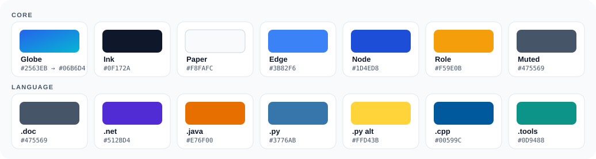

<!-- Rendered best on GitHub (SVG images + <picture> theme switching). -->

<p align="center">
  <picture>
    <source media="(prefers-color-scheme: dark)" srcset="logo/wmoop-logo-dark.svg">
    
  </picture>
</p>

<h1 align="center">Visual Identity &amp; Design System</h1>

<p align="center"><i>One mark for the world model; one derived mark per language.</i></p>

> **The logo is built the same way the project is.** A single canonical thing
> (the model / the mark), specialised per language by mechanical rules — never
> redrawn from scratch. The identity *is* the architecture, made visible.
>
> This is the full design document. For a quick reference see
> [`README.md`](README.md); for a live, interactive gallery (light/dark toggle)
> open [`preview.html`](preview.html) in a browser.

---

## 1 · The concept — what the mark means

<p align="center"></p>

Every element carries meaning from the architecture:

| Element | Meaning |
|---|---|
| **Wire globe** (circle + meridian + equator) | the **World** — the thing being modelled |
| **Nodes** (rounded squares on the globe) | **objects / classes** |
| **Edges** (the spokes) | **relations** — the object graph |
| **Amber node** | a **role** (contextual, non-exclusive) |
| **Filled diamond** on the amber edge | **composition** — the role is *attached to the whole* |

Together they state the project's central thesis — **composition and roles over
deep inheritance** (Invariant #3) — using the exact `Person` → `Driver` example
from the main README: a role, attached to an entity by composition, carrying its
own meta. The thesis is not written next to the logo; it *is* the logo.

---

## 2 · The logo family

### 2.1 Concept mark

The primary logomark. Full-colour for product/app/favicon; a single-colour
version (uses `currentColor`) for stamps, embossing and the smallest sizes.

<table>
<tr>
  <td align="center" width="25%"><br><sub><code>wmoop-mark.svg</code></sub></td>
  <td align="center" width="25%"><br><sub><code>wmoop-mark-mono.svg</code></sub></td>
  <td align="center" width="25%"><br><sub>48&nbsp;px</sub></td>
  <td align="center" width="25%"><br><sub>24&nbsp;px</sub></td>
</tr>
</table>

### 2.2 Academic / community emblem

The **scientific concept** as a circular seal — for papers, slides, the
community hub and course material. The centre is the concept mark; the ring
carries the full name. Best on **light / neutral** backgrounds.

<p align="center"></p>

### 2.3 Organisation lockup

Mark + wordmark + tagline. The image below switches with your theme; in the
repo there are explicit `-light` / `-dark` files and an auto `wmoop-logo.svg`.

<p align="center">
  <picture>
    <source media="(prefers-color-scheme: dark)" srcset="logo/wmoop-logo-dark.svg">
    
  </picture>
</p>

---

## 3 · The per-repo pattern

Everything that is **the model** stays constant across every repository: the
blue→cyan globe, the object graph, and the amber role + composition diamond.
Only **three** things change per repo — a **language-coloured orbit ring**, a
**corner chip holding the language glyph**, and the coloured **`.ext`**.

<table>
<tr>
  <td align="center"></td>
  <td align="center"></td>
</tr>
<tr>
  <td align="center"></td>
  <td align="center"></td>
</tr>
<tr>
  <td align="center"></td>
  <td align="center"></td>
</tr>
</table>

### 3.1 Colours & glyphs

| Repo | Colour | Glyph |
|------|--------|-------|
| `wmoop.doc` | `#475569` slate | stacked document sheets |
| `wmoop.net` | `#512BD4` | `#` (sharp — C#/.NET) |
| `wmoop.java` | `#E76F00` | coffee cup |
| `wmoop.py` | `#3776AB` + `#FFD43B` | two interlocking squares |
| `wmoop.cpp` | `#00599C` | `C++` |
| `wmoop.tools` | `#0D9488` teal | gear |

> The glyphs are **original, simplified renderings**, not the official language
> logos. Language names and signature colours are used nominatively, only to
> identify which binding a repo holds.

### 3.2 How to add a new language

<p align="center"></p>

1. Copy [`template/wmoop.repo-template.svg`](template/wmoop.repo-template.svg)
   to `repos/wmoop.<ext>.svg`.
2. Replace the placeholder colour (`#94A3B8`) everywhere with the language colour.
3. Swap the chip glyph (centred at `(98,98)` inside the `scale(0.85)` group).
   Copy one of the six built-in glyphs from `repos/*.svg` as a starting point.
4. Set the wordmark `.ext` and the one-line role in the tagline.

Keep the globe, ring radius, chip position, and the composition/role motif
unchanged — that consistency is the brand.

---

## 4 · Palette

<p align="center"></p>

| Token | Hex | Role |
|-------|-----|------|
| Globe | `#2563EB` → `#06B6D4` | globe gradient (blue → cyan) |
| Edge | `#3B82F6` | relations / graph edges |
| Node | `#1D4ED8` | object outlines |
| Ink | `#0F172A` | wordmark & text on light |
| Paper | `#F8FAFC` | wordmark & text on dark |
| Muted | `#475569` | taglines |
| **Role** | `#F59E0B` | the amber role node + diamond — **accent, use sparingly** |

On dark backgrounds the globe lightens to `#60A5FA → #22D3EE` and the role
accent to `#FBBF24` (see `logo/wmoop-logo-dark.svg`).

---

## 5 · Typography

- **Family:** a system sans stack — `'Segoe UI', Roboto, 'Helvetica Neue', Arial, sans-serif`.
  No web-font dependency, so the marks render identically everywhere, including
  on GitHub.
- **Wordmark:** weight **800**, slight positive letter-spacing.
- **Tagline / ring text:** weight **600–700**, wider tracking.
- **Print:** outline the text to paths before sending to a printer, so the
  wordmark is reproduced exactly regardless of installed fonts.

---

## 6 · Clear space & sizing

- **Clear space:** keep free margin of at least **half the mark's height** on all
  four sides. Nothing (text, edges, other logos) enters that zone.
- **Minimum sizes:** full-colour mark down to **24 px**; below that use
  `wmoop-mark-mono.svg`, which stays legible at 16 px.
- **Favicon / avatar:** export the mark to PNG (GitHub org avatars and `.ico`
  favicons cannot be SVG). Recommended raster sizes: 16, 32, 48, 180 (Apple
  touch), 400 (org avatar).

---

## 7 · Do &amp; Don't

**Do**

- Use the auto lockup, or the one matching the background (`-light` / `-dark`).
- Keep the globe blue→cyan in **every** repo — language colour lives only in the
  ring, the chip and `.ext`.
- Give the mark its clear space.

**Don't**

- Recolour the globe per repo.
- Move the amber role node to a different spoke, or drop the composition diamond
  — it is the point of the mark.
- Stretch, rotate, add shadows to, or re-typeset the wordmark.
- Place the full-colour wordmark text on a low-contrast background; switch
  variants instead.

---

## 8 · Accessibility &amp; theming

- The globe gradient and node outlines are chosen to hold contrast on both light
  and dark surfaces; the wordmark flips colour by theme.
- The amber **role** accent is deliberately the only warm colour — reserve it for
  its meaning so it keeps its signal.
- Every SVG carries a `<title>` (and the emblem a `<desc>`) for screen readers;
  keep these when editing.

---

## 9 · Usage snippets

Auto light/dark logo in a Markdown/README header:

```html
<p align="center">
  <picture>
    <source media="(prefers-color-scheme: dark)" srcset="brand/logo/wmoop-logo-dark.svg">
    
  </picture>
</p>
```

Per-repo header (in each `wmoop.<ext>` repository):

```html
<p align="center"></p>
```

Single-colour mark tinted by surrounding text colour:

```html
<span style="color:#512BD4">
  <!-- inline the contents of logo/wmoop-mark-mono.svg here -->
</span>
```

---

## 10 · Live preview (the example)

[`preview.html`](preview.html) is a **self-contained** gallery of the entire
system with a **light / dark toggle** — the same showcase this document
describes, but interactive. Open it directly in any browser (no build step, no
external files). It is the quickest way to review a change to any mark.

---

## 11 · Files

```
brand/
├─ README.md                      quick reference
├─ DESIGN.md                      this document
├─ preview.html                   self-contained light/dark gallery
├─ assets/
│  └─ palette.svg                 the colour swatches above
├─ logo/
│  ├─ wmoop-mark.svg              primary mark
│  ├─ wmoop-mark-mono.svg         single-colour mark
│  ├─ wmoop-emblem.svg            academic / community seal
│  ├─ wmoop-logo-light.svg        org lockup (light)
│  ├─ wmoop-logo-dark.svg         org lockup (dark)
│  └─ wmoop-logo.svg              org lockup (auto light/dark)
├─ repos/
│  ├─ wmoop.doc.svg   wmoop.net.svg   wmoop.java.svg
│  └─ wmoop.py.svg    wmoop.cpp.svg   wmoop.tools.svg
└─ template/
   └─ wmoop.repo-template.svg     blank frame + recipe
```

---

## 12 · Licensing

These brand assets are part of `wmoop.doc` and released under **CC-BY-4.0** like
the rest of the model data & documentation — reuse must credit the WMOOP project
and link back to <https://github.com/WMOOP/wmoop.doc> (see
[`../LICENSE-DATA.md`](../LICENSE-DATA.md)). The **WMOOP name, wordmark, and
marks** identify the project; please don't use them to imply endorsement of a
fork or unaffiliated work.
