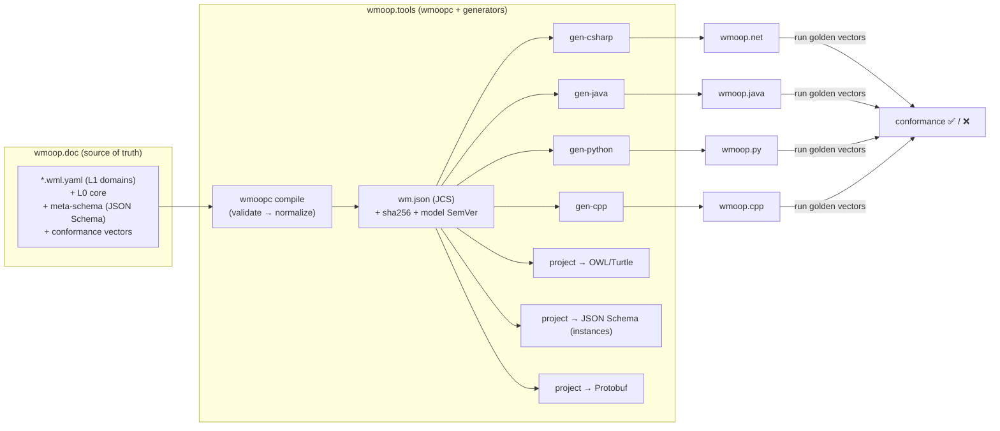

# WMOOP Platform Spec 02 — Canonical Schema Format & Cross-Language Code Generation

*Audience: contributors, binding maintainers, tooling engineers. Status: design proposal for founder/architecture review. Normative keywords (MUST/SHOULD/MAY) per RFC 2119.*

---

## 0. Scope and position in the architecture

This document specifies **how a WMOOP domain is written once and becomes idiomatic code in every language with zero conceptual duplication**. It defines three artifacts and the machinery that connects them:

1. **WML** — the *WMOOP Modeling Language*, the canonical, language-neutral format for L1 domain models (deliverable **a**).
2. **The generation pipeline** — compiler + per-language generators, and the generated/hand-written boundary that lets behaviour be added idiomatically without ever being clobbered by regeneration (deliverable **b**).
3. **The conformance suite** — a language-neutral set of golden test vectors that proves every binding is *semantically identical* (deliverable **c**).

Plus the **org repo topology, naming, and versioning** that carries a model change from source to every binding (deliverable **d**), and an **end-to-end replication walkthrough with a side-by-side parity proof** (deliverable **e**).

Everything here is bound by the eight Core Architectural Invariants. The mapping is made explicit in §6; where a design choice exists specifically to satisfy an invariant, it is flagged inline as `[INV-n]`.

---

## 1. (a) The canonical format for L1 domain models

### 1.1 What the format must do (requirements derived from the invariants)

Before comparing candidates, we fix the requirements. A format is only a good *source of truth* `[INV-1]` if it can natively express the WMOOP meta-model `[INV-2, INV-3]`:

| # | Requirement | Why |
|---|---|---|
| R1 | Abstract vs concrete **concepts** (classes) | `Vehicle` is abstract; `Moped` is concrete `[INV-3]` |
| R2 | **Single, shallow inheritance** with an enforceable depth limit | Model genuine `is-a-kind-of` essence only `[INV-3]` |
| R3 | **Interfaces/traits** (behaviour contracts) separate from classes | Composition over inheritance `[INV-3]` |
| R4 | **Roles** as first-class, composable facets with their own state, a `played_by` constraint and a context | Person-as-Driver must *not* be `Driver : Person` `[INV-3]` |
| R5 | **Properties** with type, **unit**, cardinality, defaults, and value constraints | Quantities carry units `[INV-4]` |
| R6 | **Relations** (named associations) with target type, cardinality, inverse | Cross-domain links are declared `[INV-5]` |
| R7 | **Per-concept *and per-property* metadata**: stable global ID, human name, definition, provenance/citation on every concept, role, enumeration **and property** | Every concept *and every property* is sourced `[INV-4]` |
| R8 | **Versioned modules** with an explicit, acyclic dependency graph | Domains are versioned modules `[INV-5]` |
| R9 | **Machine-checkable**: a formal grammar + automatable semantic rules | Humans *and* AI contribute against an automated DoD `[INV-6]` |
| R10 | **Codegen-friendly**: an unambiguous, closed-world mapping to OOP constructs in 4+ languages | The whole point of the pipeline |
| R11 | **Low authoring ceremony, reviewable diffs** | Students, professors, AI, and devs must contribute easily |
| R12 | **Deterministic canonical serialization** | Content-addressing and byte-identical cross-language parity (§3.2) |

### 1.2 Candidate evaluation

| Criterion | OWL / Turtle (RDF) | Protocol Buffers | JSON Schema | **WML (custom YAML/JSON DSL)** |
|---|---|---|---|---|
| World model | Open-world, non-unique-name (DL) | Closed-world data contracts | Closed-world document shapes | **Closed-world, unique-name — matches OOP** |
| Abstract/concrete classes (R1) | Classes exist; "abstract" not native | No classes, only messages | `type:object`, no abstract notion | **Native (`kind: abstract|concrete`)** |
| Inheritance (R2) | `rdfs:subClassOf`, multiple & deep by design | None (composition only) | `allOf` is set-intersection, not is-a | **Native single `extends` + enforced depth cap** |
| Interfaces/traits (R3) | Via punning/extra classes | None | None | **Native (`interfaces`)** |
| **Roles (R4)** | Modellable via object properties, but by convention only | None | None | **First-class `roles` with `played_by`/context** |
| Units on properties (R5) | Via external vocab (QUDT), verbose | No (annotations only) | No (custom keywords) | **Native (`unit` + `wmoop.core/Quantity`)** |
| Relations + inverse (R6) | Native & excellent (`owl:inverseOf`) | References by field, no semantics | `$ref` only, no inverse | **Native (`relations` + `inverse`)** |
| Provenance per concept **and property** (R7) | Via annotation properties | Comments only | `description` only | **Native, required (`provenance`)** |
| Versioned modules + acyclic deps (R8) | `owl:imports`, no version semantics | `import`, no SemVer | `$id`/`$ref`, no module versioning | **Native, with SemVer + CI acyclicity check** |
| Codegen to idiomatic OOP (R10) | Lossy & ambiguous (OWL class ≠ OOP class) | Excellent, but **DTOs only** | Decent DTO generators | **Purpose-built for this; one mapping per construct** |
| Authoring ergonomics / diffs (R11) | Steep; hard PR review | `.proto` is readable | Verbose JSON | **YAML: comments, clean diffs** |
| Reasoning/inference | **Excellent** (classifiers, consistency) | None | None | Not native — *delegated to the OWL projection* |
| Tooling maturity | High (Protégé, reasoners) | Very high | Very high | We build it (small surface) |

**The decisive mismatches:**

- **OWL/Turtle** is the most *semantically* powerful, but its open-world, non-unique-name, multiple-and-deep-subclassing model is the *opposite* of the closed-world, single-shallow-inheritance OOP target `[INV-3, INV-8]`. An OWL individual can gain and lose class membership dynamically; an OWL class is a set, not a constructor. Generating one deterministic, idiomatic class per concept from OWL requires re-imposing exactly the constraints OWL relaxes — so we would be writing WML's rules anyway, on top of a harder-to-review syntax. OWL also has no native notion of "this quantity has unit cm³ and defaults to true," and no SemVer. **It earns its place as a *projection*, not the source (§2.1).**
- **Protocol Buffers** has the best multi-language codegen in existence, but it is a *wire/DTO* schema: no inheritance, no abstract types, no roles, no relation semantics, no units. Modelling an ontology in proto throws away the modelling intent (R1–R6 all fail). **Kept as an optional projection for teams who want gRPC/wire DTOs.**
- **JSON Schema** describes the *shape of JSON documents*. `allOf` is intersection, not inheritance; there is no abstract/concrete distinction, no roles, no relations-with-inverse, no provenance-as-data. It is, however, the perfect tool for two *other* jobs — validating WML's own grammar (the **meta-schema**) and validating L2 instance data — and we use it for exactly those `[INV-6]`.

### 1.3 Decision — WML, with the standards as projections

> **We adopt `WML` (WMOOP Modeling Language): a purpose-built declarative DSL, authored in YAML, compiled to a canonical JSON form, with its grammar formally specified as a JSON Schema meta-schema. WML is the single source of truth for L1 domain models. OWL/Turtle, JSON Schema (for instances), and Protobuf are *generated projections*, never parallel sources.** `[INV-1]`

This is the central architectural move. "Which standard?" is the wrong question, because each standard is optimized for a *different downstream job*. WML is the one upstream authoring layer; the standards are downstream views:

```
                          ┌─────────────► OWL/Turtle   (reasoning, SPARQL, semantic web)
                          │
 WML (source of truth) ───┼─────────────► JSON Schema   (validate L2 instance data)
 YAML → compiled JSON     │
                          ├─────────────► Protobuf       (optional wire/gRPC DTOs)
                          │
                          └─────────────► C# / Java / Python / C++  (idiomatic OOP)
```

Why YAML-authored + JSON-compiled, rather than "just JSON" or "just YAML":

- **YAML for authoring** (R11): comments (provenance notes, TODOs), block scalars for multi-line definitions, and minimal punctuation give clean PR diffs that a student or a professor can review. The founder's academic use case (assign a student a domain) depends on this.
- **Canonical JSON as the compiled form** (R12): deterministic, tool-neutral, and content-addressable. The compiled `wm.json` — not the YAML — is what generators consume, what we hash, and what we version. YAML is the keyboard; JSON is the contract.

### 1.4 The WML meta-model (L0 constructs)

WML offers exactly these top-level declarations. This small, fixed vocabulary *is* the upper ontology `[INV-2]`:

| Construct | Role in the model | Generates to (OOP) |
|---|---|---|
| `module` | Versioned namespace + dependency list `[INV-5, INV-8]` | package / namespace |
| `datatype` | Named primitive refinement (base + constraints, optional unit) | value type / validated primitive |
| `enumeration` | Closed value set | enum |
| `concept` | A class: `abstract` or `concrete`, single `extends`, `implements`, `properties`, `relations`, `invariants` | class |
| `interface` | Behaviour contract (abstract operations only) | interface / trait / ABC |
| `role` | Composable facet: `played_by`, `context`, own `properties`/`relations`, `capabilities` | role object attached by composition `[INV-3]` |
| `individual` | L2 instance / reference datum (optional) `[INV-2]` | seed data / singleton |

Enforced semantic rules (checked by the compiler, §2.4) — these are *why* the plain structures above are safe:

- **S1 Shallow inheritance** `[INV-3]`: `extends` is single-valued; inheritance depth MUST be ≤ 6 (configurable per org, warned at 5). Violations fail CI.
- **S2 LSP-safe overrides** `[INV-3]`: a `property_override` MAY only *narrow* a parent property (e.g., tighten `maximum`, restrict an `enum` to a subset). Widening, type change, or making an optional property required in a subtype fails CI. (This is why `Moped` can cap `engineDisplacement ≤ 50` but could not *raise* `Motorcycle`'s cap.)
- **S3 Roles are not classes** `[INV-3]`: a `role` MUST declare `played_by` (a concept); it MUST NOT appear in any `extends`. A lint flags agentive-noun concepts (`…er`/`…or`, e.g. a proposed `Driver` *concept*) with "should this be a role?".
- **S4 Acyclic module graph** `[INV-5]`: `depends_on` is resolved and must be a DAG.
- **S5 Provenance present** `[INV-4]`: every `concept`, `role`, `datatype`, `enumeration`, **and every `property`** MUST carry a non-empty `definition`; and every `concept`, `role`, `enumeration`, **and every `property`** MUST carry at least one `provenance` entry. A property's `provenance` records where its **definition and documentation** come from — an external authority for a sourced term (`{ source: "ISO 3833:1977", ref: "§3.1", kind: sourced }`) or the project itself for a structural/definitional choice (`{ source: "Original WMOOP definition", kind: definitional }`). Factual property *values* at L2 additionally carry their own per-value source. A missing `definition` or `provenance` on any of these fails CI.
- **S6 Stable IDs** `[INV-4]`: every element has a globally unique, immutable ID; renames are a MAJOR change that keeps the old ID as a `deprecated_alias`.

### 1.5 Worked example — Vehicle → RoadVehicle → Motorcycle → Moped, Person, and the Driver role

Three files from two modules. This is deliberately complete so it doubles as a template.

**File `model/transport/transport.wml.yaml`** (module `wmoop.transport`):

```yaml
module:
  id: wmoop.transport
  version: 0.3.0
  title: Transport
  depends_on:
    - { module: wmoop.core,   version: "^1.0.0" }   # L0 upper ontology
    - { module: wmoop.nature, version: "^0.5.0" }   # for Person (cross-domain) [INV-5]

datatypes:
  - id: wmoop.transport/WheelCount
    name: WheelCount
    base: integer
    definition: A non-negative count of road wheels on a vehicle.
    constraints: { minimum: 0 }

enumerations:
  - id: wmoop.transport/LicenceCategory
    name: LicenceCategory
    definition: EU driving-licence categories.
    provenance:
      - { source: "Directive 2006/126/EC of the European Parliament", ref: "Annex, Art. 4" }
    values:
      - { id: AM, definition: "Mopeds, light quadricycles (≤45 km/h)" }
      - { id: A1, definition: "Light motorcycles up to 125 cm³ / 11 kW" }
      - { id: A2, definition: "Motorcycles up to 35 kW" }
      - { id: A,  definition: "All motorcycles and motor tricycles" }
      - { id: B,  definition: "Cars up to 3500 kg" }

interfaces:
  - id: wmoop.transport/IDrive
    name: IDrive
    definition: Contract for operating a road vehicle.
    operations:
      - { name: startEngine, returns: boolean }
      - name: driveTo
        params: [ { name: destination, type: wmoop.geography/Place } ]
        returns: void

concepts:
  - id: wmoop.transport/Vehicle
    name: Vehicle
    kind: abstract                               # R1 — cannot be instantiated
    definition: A man-made means of transport for moving people or goods.
    provenance:
      - { source: "ISO 3833:1977 Road vehicles — Types — Terms and definitions",
          note: "Scope narrowed to transport artifacts." }
    properties:
      - id: wmoop.transport/Vehicle#wheelCount
        name: wheelCount
        type: wmoop.transport/WheelCount
        cardinality: "1"            # exactly one
        required: true
        definition: Number of road wheels in contact with the ground.
        provenance:                 # S5 — every property is defined AND sourced [INV-4]
          - { source: "Original WMOOP definition", kind: definitional,
              note: "Aligns with the ISO 3833 road-vehicle typology." }
      - id: wmoop.transport/Vehicle#maxSpeed
        name: maxSpeed
        type: wmoop.core/Speed      # a Quantity, dimension = speed
        unit: km/h                  # R5 — units are first-class [INV-4]
        cardinality: "0..1"
        definition: The maximum design speed the vehicle can sustain on level ground.
        provenance:
          - { source: "Original WMOOP definition", kind: definitional,
              note: "Per-model figures are sourced at L2." }
    invariants:
      - id: wheels-nonneg
        expr: "self.wheelCount >= 0"
        message: "A vehicle cannot have a negative wheel count."

  - id: wmoop.transport/RoadVehicle
    name: RoadVehicle
    kind: abstract
    extends: wmoop.transport/Vehicle             # R2 — single, shallow is-a (depth 2)
    definition: A vehicle designed to travel on public roads.
    provenance:
      - { source: "Original WMOOP definition", kind: definitional }
    properties:
      - id: wmoop.transport/RoadVehicle#roadLegal
        name: roadLegal
        type: boolean
        cardinality: "1"
        default: true
        definition: Whether the vehicle is approved for use on public roads in its jurisdiction.
        provenance:
          - { source: "Original WMOOP definition", kind: definitional,
              note: "The governing jurisdiction is recorded per-instance." }

  - id: wmoop.transport/Motorcycle
    name: Motorcycle
    kind: concrete
    extends: wmoop.transport/RoadVehicle         # depth 3
    implements: [ wmoop.transport/IDrive ]
    definition: A two- or three-wheeled motor road vehicle.
    provenance:
      - { source: "Original WMOOP definition", kind: definitional }
    property_overrides:
      - property: wmoop.transport/Vehicle#wheelCount
        constraints: { enum: [2, 3] }            # S2 — narrows parent's domain, LSP-safe
    properties:
      - id: wmoop.transport/Motorcycle#engineDisplacement
        name: engineDisplacement
        type: wmoop.core/Volume
        unit: cm3
        cardinality: "1"
        definition: Total swept volume of the engine's cylinders.
        provenance:
          - { source: "Original WMOOP definition", kind: definitional,
              note: "Per-model figures are sourced at L2." }

  - id: wmoop.transport/Moped
    name: Moped
    kind: concrete
    extends: wmoop.transport/Motorcycle          # depth 4 (≤ 6, OK)
    definition: >
      A low-powered motorcycle whose engine displacement and top speed are
      limited by law (EU category L1e-B).
    provenance:
      - { source: "Regulation (EU) No 168/2013", ref: "Annex I, category L1e-B" }
    property_overrides:
      - { property: wmoop.transport/Motorcycle#engineDisplacement,
          constraints: { maximum: 50 } }          # cm³  — narrows
      - { property: wmoop.transport/Vehicle#maxSpeed,
          constraints: { maximum: 45 } }          # km/h — narrows
```

**File `model/nature/person.wml.yaml`** (module `wmoop.nature`) — `Person` is a *concept*; the deep biological tree lives in Nature, and `Person` is its leaf. `Driver` does **not** appear here:

```yaml
concepts:
  - id: wmoop.nature/Person
    name: Person
    kind: concrete
    extends: wmoop.nature/Human        # Human : Primate : … : Animal lives in biology
    definition: An individual human being.
    provenance:
      - { source: "Original WMOOP definition", note: "Legal/social person is a separate role." }
    properties:
      - id: wmoop.nature/Person#fullName
        name: fullName
        type: string
        cardinality: "1"
        definition: The person's full personal name as used for identification.
        provenance:
          - { source: "Original WMOOP definition", kind: definitional }
      - id: wmoop.nature/Person#dateOfBirth
        name: dateOfBirth
        type: date
        cardinality: "0..1"
        definition: The calendar date on which the person was born.
        provenance:
          - { source: "Original WMOOP definition", kind: definitional }
```

**File `model/transport/roles.wml.yaml`** (module `wmoop.transport`) — the cross-domain facet `[INV-3]`. `Driver` is a **role played by** a `Person`, carrying its own meta (licence number, categories, expiry). It is attached by composition, never by `Driver : Person`:

```yaml
roles:
  - id: wmoop.transport/Driver
    name: Driver
    definition: The role of a licensed person who operates a road vehicle.
    provenance:
      - { source: "Directive 2006/126/EC of the European Parliament", kind: definitional,
          note: "Role modelled from the EU driving-licence concept." }
    played_by: wmoop.nature/Person          # S3 — the natural type that can hold this role
    context:   wmoop.transport              # the domain where the role is meaningful
    cardinality_per_player: "0..1"          # a Person holds at most one Driver role
    capabilities: [ wmoop.transport/IDrive ] # behaviour unlocked while the role is active
    properties:
      - id: wmoop.transport/Driver#licenceNumber
        name: licenceNumber
        type: string
        cardinality: "1"
        definition: The identifier printed on the holder's driving licence.
        provenance:
          - { source: "Directive 2006/126/EC of the European Parliament", ref: "Annex I (security features)", kind: sourced }
      - id: wmoop.transport/Driver#licenceCategories
        name: licenceCategories
        type: wmoop.transport/LicenceCategory
        cardinality: "1..*"                 # at least one category
        definition: The EU licence categories the holder is entitled to drive.
        provenance:
          - { source: "Directive 2006/126/EC of the European Parliament", ref: "Annex, Art. 4", kind: sourced }
      - id: wmoop.transport/Driver#licenceExpiry
        name: licenceExpiry
        type: date
        cardinality: "0..1"
        definition: The date on which the licence ceases to be administratively valid.
        provenance:
          - { source: "Directive 2006/126/EC of the European Parliament", ref: "Art. 7 (administrative validity)", kind: sourced }
    relations:
      - id: wmoop.transport/Driver#operates
        name: operates
        target: wmoop.transport/RoadVehicle
        cardinality: "0..*"
        inverse: wmoop.transport/RoadVehicle#operatedBy   # R6 [INV-5]
```

This models the founder's exact example — *"a Person defined in Biology can be extended in Transport as a Driver, which is really a Person plus extra meta (driving licence, category)"* — as a **role object** (Fowler's *party/role* and the *Role Object* pattern), so a person can gain or lose the Driver facet over time, can simultaneously hold other roles (Employee, Patient), and `Person` stays a clean biological concept `[INV-3]`.

### 1.6 The compiled canonical form and content addressing

The compiler normalizes all modules into one **`wm.json`** — the compiled World Model — which is what generators and content hashing use `[INV-1]`:

- Keys sorted lexicographically; whitespace insignificant; numbers in shortest round-trip form; strings minimally escaped — i.e. **RFC 8785 JSON Canonicalization Scheme (JCS)**. This gives a byte-stable artifact across machines and OSes.
- Ordered collections (operation params, enum `values`, relation tuples) preserve declared order; unordered sets (a concept's properties) are emitted sorted by ID.
- The release carries `wm-<version>.json` plus its `sha256`. Every generated file header records that digest, so any binding can prove *which* model it was built from (§2.3, §5).

---

## 2. (b) The generation pipeline

### 2.1 Dataflow



One source, one compiled artifact, many deterministic emitters `[INV-1]`. "Write once, replicate everywhere" is this edge set — **mechanical code generation, not manual re-writing**.

### 2.2 Generated vs hand-written — the generation gap

The hard requirement: **structure is generated and owned by the pipeline; behaviour is hand-written and owned by humans; regeneration never destroys behaviour.** We solve it with the **generation-gap pattern** (Vlissides).

| Concern | GENERATED (never hand-edited) | HAND-WRITTEN (never regenerated) |
|---|---|---|
| Class skeletons (abstract/concrete), fields, typed accessors | ✅ | |
| Enums, interfaces/traits, role classes, relation accessors + inverse wiring | ✅ | |
| Validation of invariants, constraints, cardinality, units, abstractness | ✅ | |
| Equality/hashing, canonical (de)serialization, type-chain metadata | ✅ | |
| Conformance fixtures/adapters | ✅ | |
| **Method bodies / domain behaviour** (e.g. `IDrive.driveTo`, unit conversions, heuristics) | | ✅ |
| Language-specific helpers, extension methods, DI wiring | | ✅ |

Per-language realization of the gap:

| Language | Mechanism | Generated | Hand-written |
|---|---|---|---|
| **C#** | `partial class` | `Moped.Gen.cs` | `Moped.cs` (same type, behaviour half) |
| **Java** | gap subclass | `MopedGen` (abstract base) | `Moped extends MopedGen` |
| **C++** | gap subclass | `MopedGen` | `Moped : public MopedGen` |
| **Python** | gap subclass | `MopedGen` | `Moped(MopedGen)` |

The *public* type is always the stable name (`Moped`). In C# both halves are `Moped`; elsewhere the hand-written `Moped` is the public type and `MopedGen` is its generated base. For gap languages the generator emits the hand-written stub **once** if it is absent (`class Moped(MopedGen): pass`), then never touches it again.

### 2.3 Safe regeneration

Four mechanisms make `wmoopc gen` safe to run on every model release `[INV-6]`:

1. **File partition by ownership.** Generated files live under `generated/` (or carry `.g`/`Gen` in the name) and start with a machine-readable header. Hand-written files live under `src/` and are never emitted. Regeneration only ever writes `generated/`.
   ```csharp
   // <auto-generated>
   //   tool: wmoopc 1.4.0
   //   model: wm.json@sha256:9f2c… (wmoop.transport 0.3.0)
   //   DO NOT EDIT. Changes are overwritten. Add behaviour in Moped.cs (partial).
   // </auto-generated>
   ```
2. **Protected regions (fallback only).** When the gap is impractical, the generator preserves content between `// BEGIN-USER-CODE <id>` / `// END-USER-CODE <id>` markers across runs. Preferred order is *gap first, protected regions only where unavoidable*.
3. **Determinism.** Generators sort deterministically and emit via JCS-ordered input, so an unchanged model yields a zero-byte diff. No spurious churn, reviewable PRs.
4. **CI diff-guard.** Every binding's CI runs `wmoopc gen` and asserts `git diff --exit-code` over `generated/`. If a human hand-edited a generated file, or a generated file is stale versus the pinned model, CI fails. This is the automated enforcement of "generated is read-only."

### 2.4 The compiler `wmoopc` and its validation gates

`wmoopc` (in `wmoop.tools`) is the single gatekeeper. `wmoopc compile` runs, in order, and any failure blocks merge in `wmoop.doc` — this is the automated **Definition of Done** `[INV-6]`:

1. **Grammar** — validate every `*.wml.yaml` against the JSON-Schema meta-schema (this is JSON Schema's job, §1.2).
2. **Resolution** — resolve IDs and `depends_on`; assert the module graph is acyclic (S4).
3. **Semantics** — enforce S1 (depth), S2 (LSP overrides), S3 (roles-not-classes + agentive lint), S5 (provenance/definitions), S6 (stable IDs), unit/dimension consistency, relation inverse symmetry, unique IDs.
4. **Normalize** — emit `wm.json` (JCS) + `sha256` + computed model SemVer bump (§4.3 can be partially inferred by diffing against the previous release).
5. **Project/generate** — produce OWL / JSON-Schema / Protobuf projections and self-check that conformance vectors reference only existing elements.

---

## 3. (c) The conformance test suite

### 3.1 Purpose

Codegen guarantees that bindings share *structure*. Conformance guarantees they share *meaning* `[INV-1, INV-6]`: a Moped rejects a 60 cm³ engine in C#, Java, Python, and C++ identically, with the same error code, and serializes to the same bytes. The vectors live in `wmoop.doc/conformance/` and are themselves part of the versioned model.

### 3.2 Vector format and categories

A vector is a declarative `given → expect`. Categories:

| Category | Proves |
|---|---|
| **Structural/metadata** | type chain, abstractness, declared properties + units |
| **Constraint/invariant** | min/max/enum/cardinality/required + `expr` invariants |
| **Default values** | `roadLegal` defaults to `true` |
| **Override/LSP** | narrowed constraints enforced; substitutability holds |
| **Role semantics** | attach/detach, `played_by` enforcement, capability gating, per-player cardinality |
| **Relation/inverse** | setting `operates` updates `operatedBy` |
| **Enum parity** | `LicenceCategory.A2` ⇄ `"A2"` everywhere |
| **Canonical serialization** | instance → JCS JSON is **byte-identical** across all languages (the strongest parity guarantee) |

### 3.3 Worked vectors

```yaml
# conformance/transport/moped_displacement_limit.case.yaml
id: conf.transport.moped.displacement-limit
model_version: "0.3.0"
description: Moped rejects engine displacement above 50 cm³.
given:
  construct:
    type: wmoop.transport/Moped
    with: { wheelCount: 2, engineDisplacement: { value: 60, unit: cm3 } }
expect:
  outcome: validation-error
  error_code: WM-CONSTRAINT-MAX
  violated: wmoop.transport/Motorcycle#engineDisplacement
```

```yaml
# conformance/transport/driver_requires_person.case.yaml
id: conf.transport.driver.attach-requires-person
model_version: "0.3.0"
description: The Driver role can only be played by a Person.
given:
  construct: { type: wmoop.transport/Moped, bind: subject }   # a vehicle, not a Person
  attach_role: { role: wmoop.transport/Driver, to: subject }
expect: { outcome: error, error_code: WM-ROLE-PLAYER-MISMATCH }
```

```yaml
# conformance/transport/driver_capability.case.yaml
id: conf.transport.driver.capability-gated
model_version: "0.3.0"
description: IDrive capability is available only while the Driver role is held.
given:
  construct: { type: wmoop.nature/Person, with: { fullName: "Ana Pop" }, bind: p }
  assert_before: { has_capability: { subject: p, capability: wmoop.transport/IDrive }, equals: false }
  attach_role:
    role: wmoop.transport/Driver
    to: p
    with: { licenceNumber: "RO-123", licenceCategories: [AM, A1] }
expect:
  has_capability: { subject: p, capability: wmoop.transport/IDrive }
  equals: true
```

```yaml
# conformance/transport/moped_canonical_serialization.case.yaml
id: conf.transport.moped.canonical-serialization
model_version: "0.3.0"
description: Equivalent Mopeds serialize to byte-identical canonical JSON in every language.
given:
  construct:
    type: wmoop.transport/Moped
    with: { wheelCount: 2, engineDisplacement: { value: 49, unit: cm3 }, maxSpeed: { value: 45, unit: km/h } }
expect:
  canonical_json: >-
    {"@type":"wmoop.transport/Moped","engineDisplacement":{"unit":"cm3","value":49},"maxSpeed":{"unit":"km/h","value":45},"roadLegal":true,"wheelCount":2}
```

### 3.4 The per-language runner contract

Each binding ships a thin, **generated** adapter implementing one small interface, plus a hand-written harness that loads every `*.case.yaml` and runs it. A binding is declared *conformant at model vX.Y.Z* only when 100% pass in CI.

```
construct(typeId, props) -> handle | error(code)
attachRole(roleId, subject, props) -> ok | error(code)
detachRole(roleId, subject)
hasCapability(subject, capId) -> bool
getTypeChain(handle) -> [typeId, ...]
isAbstract(typeId) -> bool
getProperty(handle, propId) -> value
serializeCanonical(handle) -> string   // MUST be JCS
```

### 3.5 Canonical error-code registry

Error codes are part of the model (not per-language) so vectors are language-neutral:

| Code | Meaning |
|---|---|
| `WM-ABSTRACT-INSTANTIATION` | Attempted to construct an abstract concept |
| `WM-REQUIRED-MISSING` | Required property absent |
| `WM-CARDINALITY` | Cardinality bound violated |
| `WM-TYPE-MISMATCH` | Value type ≠ declared type |
| `WM-CONSTRAINT-MIN` / `-MAX` / `-ENUM` | Numeric/enum constraint violated |
| `WM-UNIT-DIMENSION-MISMATCH` | Unit incompatible with the property's dimension |
| `WM-INVARIANT-FAILED` | A concept `invariant` `expr` returned false |
| `WM-RELATION-TARGET-TYPE` | Relation target of wrong type |
| `WM-ROLE-PLAYER-MISMATCH` | Role attached to a concept that is not its `played_by` |
| `WM-ROLE-DUPLICATE` | `cardinality_per_player` exceeded |

---

## 4. (d) Repo topology, naming, versioning, release flow

### 4.1 Org repositories (`github.com/WMOOP`)

| Repo | Responsibility | Primary contents | Publishes |
|---|---|---|---|
| **`wmoop.doc`** | **Single source of truth** `[INV-1]` + the handbook | L0 core, L1 `*.wml.yaml`, meta-schema, conformance vectors, docs/book, released `wm.json` | `wm-<ver>.json` (GitHub Release) |
| **`wmoop.tools`** | Compiler + generators + projectors + runner SDK | `wmoopc`, `gen-*`, OWL/JSONSchema/Protobuf projectors | `wmoopc` CLI (per OS) |
| **`wmoop.net`** | C# binding | `generated/` + `src/` + harness | NuGet `Wmoop.*` |
| **`wmoop.java`** | Java binding | same shape | Maven `org.wmoop:*` |
| **`wmoop.py`** | Python binding | same shape | PyPI `wmoop-*` |
| **`wmoop.cpp`** | C++ binding | same shape | vcpkg/Conan `wmoop-*` |
| *(later)* `wmoop.web` | Ontology/metaverse explorer | reads `wm.json` | hosted site |

### 4.2 Identifier and namespace naming

| Thing | Canonical (in WML) | C# | Java | Python | C++ |
|---|---|---|---|---|---|
| Module | `wmoop.transport` | `Wmoop.Transport` | `org.wmoop.transport` | `wmoop.transport` | `wmoop::transport` |
| Concept | `wmoop.transport/Moped` | `Moped` | `Moped` | `Moped` | `Moped` |
| Property | `…/Vehicle#wheelCount` | `WheelCount` | `getWheelCount()` | `wheel_count` | `wheelCount()` |
| Enum value | `LicenceCategory.A2` | `A2` | `A2` | `A2` | `A2` |

Identifier shapes: module `wmoop.<domain>`; concept `wmoop.<domain>/<Concept>`; member `wmoop.<domain>/<Concept>#<member>`. The ID is immutable (S6); only the human name/casing is projected per language.

### 4.3 Model SemVer

The model is versioned per **module** (`wmoop.transport 0.3.0`); a **world release** pins a set of module versions. Change classification:

| Bump | Examples | Compatibility |
|---|---|---|
| **MAJOR** | remove/rename a concept/property; widen→narrow an incompatible type; optional→required; change `extends` parent; remove an enum value | breaks instances and/or generated API |
| **MINOR** | new concept/role/domain; new *optional* property; **append** enum value; new relation | backward compatible |
| **PATCH** | definition text, provenance, notes, non-normative metadata | no API/instance impact |

`wmoopc` can *propose* the bump by diffing the new `wm.json` against the last release and refuse a merge whose declared bump is smaller than the computed one.

### 4.4 Branching and the model-bump-to-binding flow

- **`wmoop.doc`**: trunk-based; `main` protected; a PR merges only when `wmoopc compile` passes all gates (§2.4) and conformance vectors are self-consistent. A release tags `model/vX.Y.Z` and cuts `wm-X.Y.Z.json`.
- **Bindings**: a **release bot** reacts to a model release by running `wmoopc gen` and opening a PR in each `wmoop.<lang>` that updates `generated/`, bumps the pinned model digest, and runs conformance. Green → auto-mergeable; red (e.g. a MAJOR removed a method a hand-written file called) → a human fixes the behaviour half. Generated code never needs manual edits.
- **Binding versioning (lockstep + local patch):** a binding's `major.minor` tracks the model it generates from; a trailing local patch covers binding-only fixes. Model `1.4.0` → `Wmoop.Transport` NuGet `1.4.0`, with `1.4.1` reserved for hand-written/binding fixes against the same model. This makes "which model does package X implement?" readable from the version string. A binding declares a compatible model range in its manifest for consumers.

### 4.5 Package independence and extension by addition

Two consumer-facing guarantees fall out of the modular model `[INV-5]`. Both are **binding requirements**, not nice-to-haves — they are what make WMOOP libraries easy to drop into any project and grow without edits.

**(a) Each domain is an independent, minimal, drop-in package.** The L0 core and every L1 domain compile to their *own* independently-versioned, independently-published package — `Wmoop.Core`, `Wmoop.Nature`, `Wmoop.Transport`, `Wmoop.Geography`, … (Maven `org.wmoop:core|nature|…`, PyPI `wmoop-core|wmoop-nature|…`, vcpkg/Conan `wmoop-core|…`). A consumer installs **only the domains they use**: each package declares exactly its own `depends_on` edges (the acyclic graph, S4), so adding `Wmoop.Nature` never drags in Transport. The only forced runtime dependency is `Wmoop.Core` — the small `ConceptId`/`Quantity`/role kernel, dependency-free, no framework or DI container — plus the domains a package itself declares. This **resolves open question §7.4 in favour of per-domain packages**, trading a few more dependency edges for easy, standalone integration.

**(b) You extend by *adding* a package, never by editing the core (OCP).** New attributes, metadata, or facets are introduced by a **new package that depends on the base** and attaches roles / qualities / classifications / relations to existing concepts *by composition* — the [Role Object](../PATTERNS.md) pattern raised to distribution scale, and the Open/Closed Principle at the package boundary. A base concept is **closed for modification, open for extension**: it is never re-opened, mutated, or forked.

> **Worked example — `Person` → Driver / Student / Teacher.** `Person` ships in `Wmoop.Nature`. Making a person a **Driver** is *already* a separate package (`Wmoop.Transport`) attaching a `Driver` role `played_by wmoop.nature/Person` — Nature is untouched and never recompiled. The *same* mechanism serves **Student** and **Teacher**: a `Wmoop.Education` domain adds those roles on `Person`. A consumer who needs all three installs `Wmoop.Nature` + `Wmoop.Transport` + `Wmoop.Education`; one who needs only biology installs `Wmoop.Nature` alone.

**Out-of-tree extension is first-class.** The identical mechanism works for facets WMOOP does *not* model canonically: a consumer or third party publishes **their own** complementary package (e.g. `Acme.Payroll` attaching an `Employee` role to `Person`) against the public, immutable concept **IDs** (S6) and the role machinery — **no upstream contribution and no fork required**. In-tree (a governed WMOOP domain) and out-of-tree (a private or third-party add-on) differ only in *where* they are published and whether they are ratified; the extension surface is the same. Such a package:

- may **add** — roles, qualities, classifications, relations, and wholly new concepts — but must **not** mutate, re-open, or redefine a base concept's committed shape;
- references the base only through declared, versioned **cross-domain relations** `[INV-5]` and stable **IDs** (S6), never generated names;
- **pins a compatible model range** (§4.4), so a base MAJOR bump cannot silently break it.

---

## 5. (e) Replication walkthrough, with a side-by-side parity proof

### 5.1 Two contribution workflows

**Workflow A — canonical, DSL-first (the norm)** `[INV-1]`:

1. Contributor edits `model/transport/*.wml.yaml` in `wmoop.doc` (a student adds `Moped`; a professor reviews).
2. PR CI runs `wmoopc compile` — the automated DoD. Merge on green.
3. Model release `transport 0.3.0` cuts `wm.json`.
4. The bot regenerates `wmoop.net`, `wmoop.java`, `wmoop.py`, `wmoop.cpp`. **This is the replication** — all four languages update from one source; nobody re-writes `Moped` four times.

**Workflow B — a C#-developer's on-ramp (optional, honours the founder's "write it in C#" wish without a second source of truth):**

1. A C#-thinking contributor sketches the concept as annotated C#:
   ```csharp
   [WmConcept("wmoop.transport/Moped", Extends = "wmoop.transport/Motorcycle",
              Definition = "Low-powered motorcycle (EU L1e-B).")]
   public partial class Moped
   {
       [WmOverride("…/Motorcycle#engineDisplacement", Max = 50)]  // cm³
       [WmOverride("…/Vehicle#maxSpeed", Max = 45)]               // km/h
       public partial void _markers() {}
   }
   ```
2. `wmoopc import --from csharp` **lifts** the annotations into a proposed `moped.wml.yaml` and reports any detail it could not capture (lossiness is surfaced, never silently dropped).
3. The contributor submits that YAML to `wmoop.doc` → from here it is Workflow A.

> The C# sketch is an **input to authoring**, reviewed as a `wml.yaml` PR. It is never a parallel source of truth `[INV-1]`. The repo that is edited is always `wmoop.doc`; the thing reviewed is always WML.

### 5.2 Parity proof — one concept, three views

**Model (the single source):**

```yaml
- id: wmoop.transport/Moped
  kind: concrete
  extends: wmoop.transport/Motorcycle
  property_overrides:
    - { property: wmoop.transport/Motorcycle#engineDisplacement, constraints: { maximum: 50 } }
    - { property: wmoop.transport/Vehicle#maxSpeed,              constraints: { maximum: 45 } }
```

**Generated C#** — `wmoop.net/generated/Transport/Moped.Gen.cs`:

```csharp
// <auto-generated> wmoopc 1.4.0 • wm.json@sha256:9f2c… (wmoop.transport 0.3.0) • DO NOT EDIT </auto-generated>
#nullable enable
namespace Wmoop.Transport;

public partial class Moped : Motorcycle
{
    public const string WmId = "wmoop.transport/Moped";

    public Moped(int wheelCount, Quantity engineDisplacement,
                 Quantity? maxSpeed = null, bool roadLegal = true)
        : base(wheelCount, engineDisplacement, maxSpeed, roadLegal) { }

    protected override void Validate(WmValidationContext ctx)
    {
        base.Validate(ctx);
        ctx.RequireDimension(nameof(EngineDisplacement), EngineDisplacement, "volume");
        ctx.Max("…/Motorcycle#engineDisplacement", EngineDisplacement.In("cm3"), 50,   "WM-CONSTRAINT-MAX");
        if (MaxSpeed is { } s)
            ctx.Max("…/Vehicle#maxSpeed",           s.In("km/h"),               45,   "WM-CONSTRAINT-MAX");
    }
}
```

**Generated Python** — `wmoop/py/generated/transport/moped_gen.py`:

```python
# @generated wmoopc 1.4.0 • wm.json@sha256:9f2c… (wmoop.transport 0.3.0) — DO NOT EDIT
from __future__ import annotations
from wmoop.core import Quantity, WmValidationContext
from .motorcycle import Motorcycle

class MopedGen(Motorcycle):
    WM_ID = "wmoop.transport/Moped"

    def __init__(self, *, wheel_count: int, engine_displacement: Quantity,
                 max_speed: Quantity | None = None, road_legal: bool = True) -> None:
        super().__init__(wheel_count=wheel_count, engine_displacement=engine_displacement,
                         max_speed=max_speed, road_legal=road_legal)

    def _validate(self, ctx: WmValidationContext) -> None:
        super()._validate(ctx)
        ctx.require_dimension("engine_displacement", self.engine_displacement, "volume")
        ctx.max("…/Motorcycle#engineDisplacement", self.engine_displacement.in_("cm3"), 50, "WM-CONSTRAINT-MAX")
        if self.max_speed is not None:
            ctx.max("…/Vehicle#maxSpeed",           self.max_speed.in_("km/h"),         45, "WM-CONSTRAINT-MAX")
```

Same constraints, same error code `WM-CONSTRAINT-MAX`, same canonical serialization — enforced by the shared vector `conf.transport.moped.displacement-limit` and `…canonical-serialization` (§3.3). Java and C++ emit the structurally identical `MopedGen` base; Python/Java/C++ add the one-time hand-written `Moped(MopedGen)`/`class Moped : MopedGen` stub, C# uses the second partial half.

**The Driver role — composition, not inheritance, in both languages.** Generated:

```csharp
// generated
public partial class Driver : WmRole<Person>          // played_by = Person
{
    public const string WmId = "wmoop.transport/Driver";
    public required string LicenceNumber { get; init; }
    public required IReadOnlyList<LicenceCategory> LicenceCategories { get; init; }
    public DateOnly? LicenceExpiry { get; init; }
}
```
```python
# generated
class DriverGen(WmRole[Person]):                      # played_by = Person
    WM_ID = "wmoop.transport/Driver"
    licence_number: str
    licence_categories: list[LicenceCategory]
    licence_expiry: date | None = None
```

Usage is composition in both — a `Person` *assumes* the role:

```csharp
Person ana = new(fullName: "Ana Pop");
ana.AssumeRole(new Driver { LicenceNumber = "RO-123", LicenceCategories = [LicenceCategory.AM] });
bool canDrive = ana.HasCapability<IDrive>();          // true only while the role is held
```
```python
ana = Person(full_name="Ana Pop")
ana.assume_role(Driver(licence_number="RO-123", licence_categories=[LicenceCategory.AM]))
can_drive = ana.has_capability(IDrive)                # true only while the role is held
```

Attaching `Driver` to a non-`Person` fails with `WM-ROLE-PLAYER-MISMATCH` in every binding (vector `conf.transport.driver.attach-requires-person`). `Person` is never subclassed by `Driver` `[INV-3]`.

### 5.3 What actually guarantees parity (recap)

1. **One source** (`wm.json`, JCS, content-addressed) feeds every generator `[INV-1]`.
2. **Deterministic generators** + the **CI diff-guard** keep `generated/` an exact function of the model.
3. **The conformance suite** turns "semantically identical" into a pass/fail gate, including **byte-identical canonical serialization** and a **shared error-code registry**.
4. **The generation gap** lets behaviour differ *idiomatically* per language while structure and meaning stay locked.

---

## 6. Alignment with the Core Architectural Invariants

| Invariant | Where honoured |
|---|---|
| **1 — Schema-first, single source of truth; replication is mechanical** | WML in `wmoop.doc` is the only source; standards are projections (§1.3); bindings generated + diff-guarded (§2); C#-first is an on-ramp, not a second source (§5.1) |
| **2 — L0/L1/L2 layering** | L0 = the fixed WML meta-model + `wmoop.core` (§1.4); L1 = `concept`/`role`/`relation` declarations (§1.5); L2 = `individual` + JSON-Schema instance validation (§1.3, §1.4) |
| **3 — Composition/interfaces/roles over deep inheritance; shallow, LSP-safe** | `role` is first-class with `played_by` (§1.4–1.5); S1 depth cap, S2 LSP overrides, S3 roles-not-classes + agentive lint (§1.4); Driver-as-role proof (§5.2) |
| **4 — Every concept: ID, name, definition, provenance, units** | Required by S5/S6; `unit` + `wmoop.core/Quantity` + dimension checks (§1.4–1.5, §3) |
| **5 — Versioned modules, acyclic deps, declared cross-domain links** | `module.version` + `depends_on` DAG (S4); versioned `relation` across `wmoop.nature`↔`wmoop.transport`; model SemVer (§4.3) |
| **6 — Machine-checkable DoD for humans and AI** | meta-schema + `wmoopc` gates (§2.4) + conformance suite + CI diff-guard (§2.3, §3) |
| **7 — Ontological completeness (endurants, perdurants, abstracts first-class)** | WML's fixed L0 vocabulary models concepts, roles, interfaces, relations and individuals as first-class (§1.4); the full endurant/perdurant/abstract coverage that makes domains such as Math and Music modellable is specified in the meta-model (§9) |
| **8 — Identity lifecycle & world-stance** | Stable, immutable IDs with `deprecated_alias` on rename (S6, §1.4; rename = MAJOR, §4.3); closed-world, unique-name stance matching the OOP target (§1.2); the sameAs/merge policy and open-world-for-facts rules are specified in the meta-model (§9) |

---

## 7. Open questions for founder/architecture review

1. **Role identity & lifetime at L2:** is a `Driver` role globally identified, or only relative to its player? Affects serialization and cross-domain references.
2. **Relation storage ownership:** does `operates`/`operatedBy` live on the role, the vehicle, or a separate association object? (Recommend association-owned for many-to-many; decide before many relations exist.)
3. **Expression language for `invariants`:** adopt a tiny, sandboxed subset (CEL-like) that every language can evaluate identically, so invariants are part of conformance rather than hand-ported.
4. **Module granularity — decided (§4.5):** per-domain packages (`Wmoop.Nature`, `Wmoop.Transport`, …), so each domain is independently consumable and extensible by addition; the accepted cost is more dependency edges to keep acyclic (S4). Open sub-question: whether unusually large domains later split into sub-domain packages.
5. **C#-first on-ramp scope:** ship the `import --from csharp` lifter in v1, or start DSL-only and add on-ramps once the model stabilizes?
6. **Behaviour conformance:** §3 pins *structure and constraints*; should a later suite also pin selected *behaviours* (e.g. unit conversions) via input/output vectors, accepting that it narrows idiomatic freedom?