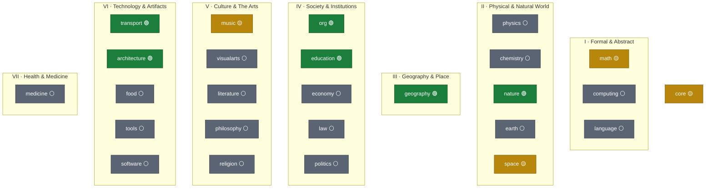
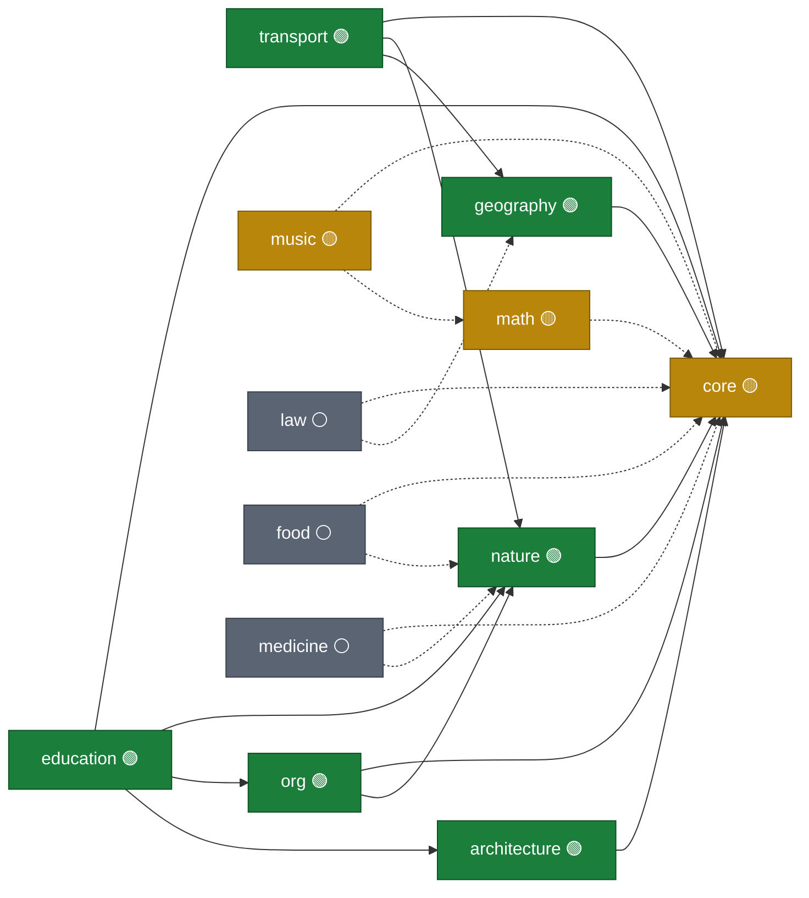

# The World Domain Map — WMOOP's L1 Taxonomy

> **Document role.** This is the proposed **top-level categorisation of the World Model**: the
> domains (L1 modules) WMOOP models, grouped into clusters, with their sub-domains and their
> dependency structure. It answers the question "what are the big categories of the world, and how
> do they nest?" — the *subject* map, sitting on top of the fixed L0 meta-model
> ([`02-meta-model.md`](02-meta-model.md)) and feeding the domain-authoring work
> ([`model/`](../model/)).
>
> **Status:** Draft for ratification (v0). The seed domains are fixed; the candidate domains are a
> proposal and are **opt-in and maintainer-gated** (whitepaper §6, *Scope explosion*).
> **Single source:** the machine-readable registry [`model/taxonomy.yaml`](../model/taxonomy.yaml).
> The two diagrams below are generated from it (see [§6](#6-keeping-the-map-current)).

---

## 1. What "category" means here

WMOOP uses the word *category* in two unrelated senses; this document is about the **first**:

1. **Domain category (this document).** A broad *subject area* of the world — Nature, Music,
   Transport, Geography — realised as a versioned **L1 module**. These are organised into a
   four-level hierarchy:

   | Level | What it is | Example | Generated code? |
   |---|---|---|---|
   | **Cluster** | organisational grouping (no code) | *Physical & Natural World* | no |
   | **Domain** | a versioned L1 **module** (`wmoop.<id>`) | `nature` | yes — a package |
   | **Sub-domain** | a package path inside a module (a QName segment) | `nature.animals` | yes — a namespace |
   | **Concept** | a class / role / relation at L1 | `nature.animals:Dog` | yes — a type |

2. **`Category` stereotype (NOT this document).** In the meta-model, `Category` is a *cross-cutting
   tag* (a non-sortal mixin such as `CulinaryVegetable`) used for multiple classification. That is a
   modelling tool inside a domain, defined in [§3 of the meta-model](02-meta-model.md#3-authoring-stereotypes--the-only-vocabulary-l1-may-use).
   Don't confuse it with the domain categories here.

This map is deliberately **not** a single inheritance tree. Clusters group domains for navigation;
the real machine-checkable structure is the **acyclic dependency graph** between modules
([§5](#5-the-dependency-graph-living)), exactly as Invariant 5 requires.

---

## 2. Research basis

The top-level groupings are not invented from scratch; they are triangulated from the major
knowledge-classification systems and upper ontologies, then adapted to WMOOP's OOP/role discipline.
Recording this lineage is itself an application of Invariant 4 (*everything is sourced*).

| System | Top-level shape | What WMOOP borrows |
|---|---|---|
| **Dewey Decimal (DDC)** | 10 classes (Science 500, Technology 600, Arts 700, Social sciences 300, …) | the breadth of "all knowledge" split into ~10 peers; separating *Science* from *Technology* |
| **Library of Congress (LCC)** | 21 lettered classes (Q Science, T Technology, M Music, G Geography, H Social sciences, R Medicine, …) | first-class **Music**, **Geography** and **Medicine** as their own top-level areas |
| **OECD Fields of Science (FOS)** | 6 fields: Natural, Engineering & Tech, Medical & Health, Agricultural, Social, Humanities | the cluster backbone (Natural / Technology / Health / Society / Culture) |
| **SUMO** (upper ontology) | Physical vs Abstract (in space-time vs neither) | the Natural ↔ Formal split; aligns with L0's Endurant/Perdurant vs Abstract |
| **schema.org** | `Thing` → Action, CreativeWork, Event, Organization, Person, Place, Product, Taxon, MedicalEntity… | developer-facing anchors: Place→Geography, Organization→Society, Product→Economy, Taxon→Nature |
| **Wikipedia — Outline of knowledge / academic disciplines** | Formal, Natural, Social sciences, Humanities; levels Domain → Field → … → Discipline | the explicit multi-level hierarchy (our Cluster → Domain → Sub-domain → Concept) |

**How WMOOP differs from all of them.** Those systems classify *documents* or *facts*. WMOOP
classifies *things in order to generate typed code*, so the map also has to respect the three
distinctions the others blur: **is-a vs part-of vs role** (Transport sits apart from Nature because
`Driver` is a *role on* a `Person`, not a kind of person), and the **endurant / perdurant /
abstract** split (Music is one domain that spans all three). The clusters therefore track OECD's
fields, but the *domains* are cut along modelling seams, not library-shelf seams.

---

## 3. The top-level categories

Eight top-level groups: the **Foundation** plus **seven clusters**. Legend:
🟢 **seeded** (a module exists in [`model/`](../model/)) · 🟡 **planned** (named in the
README/whitepaper seed taxonomy or v1 roadmap) · ⚪ **candidate** (proposed here; needs a steward).

| # | Cluster | Domains | Grounded in |
|---|---|---|---|
| 0 | **Foundation** | `core` 🟡 | — (realises L0) |
| I | **Formal & Abstract** | `math` 🟡 · `computing` ⚪ · `language` ⚪ | DDC 500/000, OECD Natural/Formal, SUMO *Abstract* |
| II | **Physical & Natural World** | `physics` ⚪ · `chemistry` ⚪ · `nature` 🟢 · `earth` ⚪ · `space` 🟡 | DDC 500, OECD Natural, LCC Q, schema.org Taxon |
| III | **Geography & Place** | `geography` 🟢 | LCC G, DDC 910, schema.org Place |
| IV | **Society & Institutions** | `org` 🟢 · `education` 🟢 · `economy` ⚪ · `law` ⚪ · `politics` ⚪ | DDC 300/370, OECD Social, LCC H/J/K/L, schema.org Organization/EducationalOrganization |
| V | **Culture & The Arts** | `music` 🟡 · `visualarts` ⚪ · `literature` ⚪ · `philosophy` ⚪ · `religion` ⚪ | DDC 100/200/400/700/800, OECD Humanities, LCC B/M/N/P |
| VI | **Technology & Artifacts** | `transport` 🟢 · `architecture` 🟢 · `food` ⚪ · `tools` ⚪ · `software` ⚪ | DDC 600, OECD Engineering, LCC T, schema.org Product |
| VII | **Health & Medicine** | `medicine` ⚪ | OECD Medical & Health, LCC R, schema.org MedicalEntity |

---

## 4. The full hierarchy

Each sub-domain lists an example concept and, where useful, its dominant L0 category
(**End**urant · **Perd**urant · **Abs**tract · **Role** · **Rel**ation).

### 0 · Foundation
- **`core`** 🟡 — realises L0; every module depends on it.
  - `core.quantities` — `Length`, `Mass`, `Speed`, `Count` (Abs)
  - `core.units` — `m`, `kg`, `km_per_h`, `cm3`
  - `core.dimensions` — the SI 7-vector (L,M,T,I,Θ,N,J)
  - `core.provenance` · `core.identity` — citations, `wmid`/QName
  - *Referenced everywhere as `wmoop.core`; the module file is still pending.*

### I · Formal & Abstract
- **`math`** 🟡 — `math.number` (`NaturalNumber`, Abs) · `math.algebra` (`Group`, Abs) ·
  **`math.geometry`** 🟡 (`Polygon`, Abs) · `math.analysis` · `math.logic` · `math.probability` ·
  `math.settheory` (`Set`, Collection).
- **`computing`** ⚪ — `computing.datastructures` (`Tree`) · `computing.algorithms` (`SortAlgorithm`,
  Perd) · `computing.information`.
- **`language`** ⚪ — `language.phonology` (`Phoneme`, Abs) · `language.morphology` ·
  `language.syntax` · `language.semantics` · `language.writingsystems` (`Alphabet`).

### II · Physical & Natural World
- **`physics`** ⚪ — `physics.mechanics` (`Force`, Quality) · `physics.electromagnetism` ·
  `physics.thermodynamics` · `physics.particles` (`Electron`, End) · `physics.quantum`.
- **`chemistry`** ⚪ — `chemistry.elements` (`Element`, End) · `chemistry.compounds` (`Molecule`,
  End) · `chemistry.reactions` (`Combustion`, **Perd**).
- **`nature`** 🟢 — `nature.taxonomy` (ranks as `classified_as` facts, not inheritance) ·
  **`nature.animals`** 🟡 (`Animal → Human`) · **`nature.plants`** 🟡 (`Tomato`) · `nature.fungi` ·
  `nature.microbes` · **`nature.anatomy`** 🟢 (`AnatomicalStructure → Organ`; `Heart/Brain/Lung/…`;
  `OrganSystem` Collection; `Organ part_of Animal`) · `nature.genetics` (`Cell`, `DNA` —
  roadmap *depth on demand*) · `nature.people` (`Person`, End — the flagship role *player*).
- **`earth`** ⚪ — `earth.landforms` (`Mountain`, End) · `earth.geology` · `earth.hydrology`
  (`River`) · `earth.atmosphere` · `earth.climate`.
- **`space`** 🟡 — `space.solarsystem` (`Planet`, End; the 8 planets are **L2** instances) ·
  `space.stars` · `space.galaxies` · `space.cosmology`.

### III · Geography & Place
- **`geography`** 🟢 — **`geography.admin`** 🟢 (`Country ⊃ County ⊃ City` via **part-of**, plus
  `Jurisdiction`) · `geography.physical` (links to `earth.landforms`, never copies it) ·
  `geography.human` (`Settlement`, `Region`) · `geography.coordinates` (`GeoPoint`).

### IV · Society & Institutions
- **`org`** 🟢 — `org.structure` (`Organization`, End) · `org.employment` (`Employee`, **Role** on a
  `Person` — the role the meta-model references).
- **`education`** 🟢 — `education.institutions` (`School` is-a `Organization`, **not** a `Building`;
  `SchoolBuilding` is-a `architecture/Building`) · `education.roles` (`Student`, `Teacher`,
  `FormTutor`/RO *diriginte* — **Roles** on `Person`, co-held) · `education.curriculum`
  (`CurriculumSubject`, **Abs**; `Mathematics`/`Biology`/`Music` as **L2**) · `education.assessment`
  (`Mark` — a reified grade).
- **`economy`** ⚪ — `economy.money` (`Currency`) · `economy.markets` · `economy.products` (`Product`,
  `Offer`).
- **`law`** ⚪ — `law.jurisdiction` · `law.rights` · `law.licences` (`DrivingAuthorisation` — the
  relational ground of the `Driver` role).
- **`politics`** ⚪ — `politics.state` (`State`) · `politics.governance`.

### V · Culture & The Arts
- **`music`** 🟡 — **`music.theory`** 🟡 (`PitchClass`, `Interval`, `Chord` — **Abs**/Collection) ·
  **`music.instruments`** 🟡 (`Violin`, **End**) · `music.performance` (`NoteOccurrence`, **Perd**).
  *The one domain that exercises all three ontological categories at once.*
- **`visualarts`** ⚪ · **`literature`** ⚪ (`Poem`) · **`philosophy`** ⚪ · **`religion`** ⚪
  (`Tradition`, `Myth`).

### VI · Technology & Artifacts
- **`transport`** 🟢 — **`transport.vehicles`** 🟢 (`Vehicle → RoadVehicle → Motorcycle → Moped`,
  shallow **is-a**) · **`transport.driving`** 🟢 (`Driver`, **Role**) · `transport.ownership`
  (`VehicleOwner`, **Role**).
- **`architecture`** 🟢 — `architecture.buildings` (`Building`, End; `Room` **part_of** `Building`) ·
  `architecture.structures`. · **`food`** ⚪ (`Dish`; home of the `CulinaryVegetable`
  category) · **`tools`** ⚪ · **`software`** ⚪.

### VII · Health & Medicine
- **`medicine`** ⚪ — `medicine.anatomy` (builds on `nature.anatomy`) · `medicine.conditions`
  (`Disease`) · `medicine.treatments` (`Surgery`, **Perd**).

---

## 5. The cluster map (living)

Containment view — clusters and the domains inside them. Colour = status.



---

## 6. The dependency graph (living)

The machine-checkable structure. **An arrow `A → B` reads "A depends on B"** (A references B's
concepts). The graph MUST stay acyclic (Invariant 5); CI rejects a cycle. Solid edges are declared
by a seeded module today; dashed edges are what a candidate domain will declare once authored.



Notice the direction never reverses: **Nature knows nothing about Transport**, even though Transport
attaches a `Driver` role to Nature's `Person`. That one-way edge is what keeps the crowd-sourced
domains independently versionable.

---

## 7. Keeping the map current

"A diagram kept up to date all the time" is a generation problem, not a drawing problem — so WMOOP
treats it the same way it treats code (Invariant 1: *generated, never hand-copied*).

1. **One source of truth.** [`model/taxonomy.yaml`](../model/taxonomy.yaml) lists every cluster and
   domain with its `status`, `steward`, `subdomains` and `depends_on`. It is the only place a human
   edits.
2. **The diagrams are outputs.** The cluster map ([§5](#5-the-cluster-map-living)) and the dependency
   graph ([§6](#6-the-dependency-graph-living)) are rendered **from** that registry — and the
   dependency graph is cross-checked against the real `depends_on:` headers in each
   `model/**/*.wml.yaml`, so a drawing can never claim an edge the model doesn't have.
3. **CI gate (planned, part of `wmoop.tools`).** On every PR, regenerate both diagrams and `diff`
   them against what is committed here; **fail if stale** — the same snapshot discipline as the
   cross-language conformance tests. A new or moved domain *cannot* merge with an out-of-date map.
4. **Until the generator lands**, this is enforced by a one-line contributor checklist: *"added or
   moved a domain? update `model/taxonomy.yaml` and regenerate the two diagrams in
   `docs/06-domain-taxonomy.md`."* (A good first-tool issue: a ~100-line script that reads the
   registry + module headers and emits the two ```mermaid blocks.)

This way the map in this file is always a faithful projection of the model, exactly as `wmoop.net`
is a faithful projection of the WML.

---

## 8. Open decisions (for ratification)

1. **Geography's home.** The README lists Geography *under* Nature, but the model already ships it as
   its own module that Transport depends on. This document promotes **Geography to its own top-level
   cluster (III)**, because it is depended on by Transport, Law and Politics and bridges physical and
   administrative space. *Recommendation: adopt that, and update the README's one line to match.*
2. **`core` as a real module.** It is referenced everywhere as `wmoop.core` but has no file yet.
   *Recommendation: author `model/core/` first (it blocks every other module's validation).*
3. **Science vs Technology split.** We keep DDC's distinction: `physics`/`chemistry` (knowledge) sit
   in cluster II; `transport`/`tools`/`software` (artifacts) sit in cluster VI. Agreed, or merge?
4. **Depth of candidate clusters.** VII (Health) and parts of IV/V are large. Per the *scope
   explosion* mitigation they stay **candidate** until each has a steward and sources — none is added
   to `model/` on the strength of this map alone.
5. **Cluster count.** Seven clusters track OECD's six fields + a Foundation. Is a separate
   **Agriculture** cluster (OECD's sixth) wanted, or does `food` + `nature.plants` cover it?

---

## 9. Sources

- Dewey Decimal Classification — list of ten main classes: <https://en.wikipedia.org/wiki/List_of_Dewey_Decimal_classes>
- Library of Congress Classification — class outline A–Z: <https://www.loc.gov/catdir/cpso/lcco/>
- OECD Fields of Science and Technology (Frascati Manual) — six major fields: <https://en.wikipedia.org/wiki/Fields_of_Science_and_Technology>
- Suggested Upper Merged Ontology (SUMO) — physical vs abstract upper categories: <https://en.wikipedia.org/wiki/Suggested_Upper_Merged_Ontology>
- schema.org — direct subtypes of `Thing`: <https://schema.org/Thing>
- Wikipedia — Outline of academic disciplines / Outline of knowledge: <https://en.wikipedia.org/wiki/Outline_of_academic_disciplines>

*Classification systems are used as structural inspiration; WMOOP's cuts follow its own modelling
rules (is-a vs part-of vs role; endurant vs perdurant vs abstract). Per-concept provenance is
recorded on each concept in its WML file (Invariant 4), not here.*
