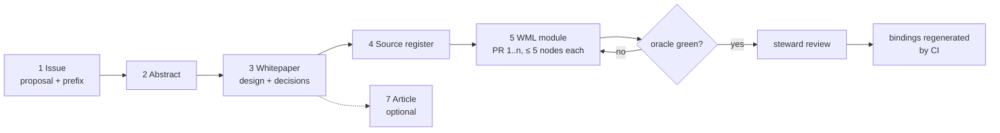
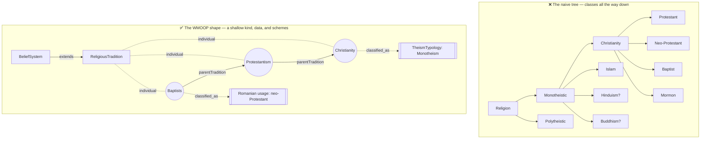

# Contributing a Domain — from an idea to a merged, generated model

> **Document role.** A practical guide for **domain experts who are not (yet) programmers** — a
> theology student, a geography teacher, a music-theory researcher — who want to add a whole subject
> to WMOOP. It says **which documents you write, in what order, how each one is structured, and the
> writing standard reviewers hold you to**, and it shows how prose about a subject becomes WML objects.
> It adds no rule of its own: the normative rules stay in [`CONTRIBUTING.md`](../CONTRIBUTING.md),
> [`ETHICS.md`](../ETHICS.md), [`02-meta-model.md`](02-meta-model.md) and
> [`03-architecture.md`](03-architecture.md), and this guide links to them.
>
> **Status:** Proposed (v0). **Worked example:** the `wmoop.religion` dossier in
> [`domains/religion/`](domains/religion/) and the module
> [`model/religion/religion.wml.yaml`](../model/religion/religion.wml.yaml), written as if by a
> theology student.

---

## 0. The short version

1. **Open a domain proposal issue** with the [New domain](../.github/ISSUE_TEMPLATE/new-domain.yml)
   form. Wait for a maintainer to reserve the `wmoop.<id>` prefix.
2. **Write the dossier** in `docs/domains/<id>/`: an **abstract**, a **whitepaper** (the domain
   design document) and a **source register**. Copy the templates from [`domain-kit/`](domain-kit/).
3. **Model it in WML**, in small pull requests of at most five nodes, starting from
   [`model/_template/DOMAIN_TEMPLATE.wml.yaml`](../model/_template/DOMAIN_TEMPLATE.wml.yaml).
4. **Run the oracle** until it is green: `python schema/validate_wml.py --strict` and
   `python tools/gen_taxonomy.py --check`.
5. **Optionally write the article**, a readable account of the domain for students and the public.

You never write C#, Java, Python, C++ or TypeScript. The bindings are generated from your WML.

---

## 1. The dossier — what you write and why

Each document answers one question for one audience. Keeping them apart is what makes each one short.

| # | Artefact | Answers | Audience | Size | Where it lives | Required? |
|---|----------|---------|----------|------|----------------|-----------|
| 1 | **Issue** (domain proposal) | *Should this domain exist, and who looks after it?* | maintainers | one screen | GitHub issue, [form](../.github/ISSUE_TEMPLATE/new-domain.yml) | always, first |
| 2 | **Abstract** | *What is this domain, in one paragraph?* | everyone | 150–250 words | `docs/domains/<id>/ABSTRACT.md` | new domain |
| 3 | **Whitepaper** (domain design document) | *How is it modelled, and why this way?* | stewards, reviewers | 6–15 pages | `docs/domains/<id>/WHITEPAPER.md` | new domain, or a redesign |
| 4 | **Source register** | *What does the model rest on, and how reliable is it?* | reviewers | one entry per source | `docs/domains/<id>/SOURCES.yaml` | new domain |
| 5 | **WML module** | *The model itself* | machines, reviewers | ≤ 5 nodes per PR | `model/<id>/<id>.wml.yaml` | always |
| 6 | **Conformance cases** | *What must every binding do with it?* | binding authors | 1–3 cases | `conformance/<id>/*.case.yaml` | when a rule is worth pinning |
| 7 | **Article** | *What does a reader learn from this domain?* | students, public | 800–1500 words | `docs/domains/<id>/ARTICLE.md` | optional, recommended |
| 8 | **Pull request** | *What did this step change?* | reviewers | the [PR template](../.github/PULL_REQUEST_TEMPLATE.md) | GitHub | every change |

**How they relate.** The issue is the *request*; the whitepaper is the *design* and the only
document that is normative for the domain; the abstract is a *summary* of the whitepaper; the WML is
the *implementation* of the whitepaper; the article is an *explanation* for readers and never
introduces a decision that the whitepaper does not hold. When the WML and the whitepaper disagree,
fix one of them in the same PR.

---

## 2. Stage by stage

### 2.1 The issue — the domain proposal

Use the **New domain** form. It is the "domain brief" of
[`07-expansion-roadmap.md` §6](07-expansion-roadmap.md#6-the-domain-brief-make-any-domain-tractable)
with the extra fields reviewers asked for most. A professional proposal:

- **Has a title of the form** `[domain] <Name>` and names the module id (`wmoop.religion`).
- **Opens with the abstract** (the same text as `ABSTRACT.md`), so a maintainer can decide in a minute.
- **States scope *and* non-scope.** What is out is as important as what is in.
- **Lists the seed concepts with their L0 stereotype** (Kind, Subkind, Role, Category, …) and the
  relation each one uses. If you cannot say which, you are not ready to model it; say so and ask.
- **Names the contested points** and how you will represent them (schemes, attributed claims), not
  how you will settle them.
- **Lists sources by tier** (A/B/C, [`ETHICS.md` §2.2](../ETHICS.md)), with ISBN, DOI or URL.
- **Names a steward** who will review the domain's PRs, and a PR plan.
- **Is short.** Detail goes in the whitepaper; link to it once it exists.

The worked example is [`domains/religion/ISSUE.md`](domains/religion/ISSUE.md).

### 2.2 The abstract

One paragraph, 150–250 words, in this order: **context** (what part of the world), **problem**
(why it is hard to model), **approach** (the two or three modelling decisions that carry the domain),
**result** (what the first version contains), **limits** (what it deliberately leaves out). No
citations, no lists, no claims that the whitepaper does not support.
Template: [`domain-kit/ABSTRACT.template.md`](domain-kit/ABSTRACT.template.md).

### 2.3 The whitepaper — the domain design document

This is the document reviewers read before your first WML PR. It has a fixed outline so that every
domain can be reviewed the same way:

| § | Section | What it must contain |
|---|---------|----------------------|
| 0 | Metadata | module id, version, status, steward(s), related issue, `depends_on` |
| 1 | Abstract | the abstract, verbatim |
| 2 | Motivation and use cases | who uses this model and for what; two or three concrete uses |
| 3 | Scope | in scope, out of scope, neighbouring domains and where the border runs |
| 4 | Background | the scholarly frame of the subject, with sources; the standard vocabularies |
| 5 | Analysis | the naive model a newcomer would draw, and why it changes (see §4 below) |
| 6 | The model | concepts, roles, datatypes, enumerations, schemes and individuals, with a diagram and a table that gives each concept's L0 category and stereotype |
| 7 | Property catalogue | every property: name, type, cardinality, meaning, why it exists, source |
| 8 | Classification schemes | each contested or perspectival grouping as its own sourced scheme |
| 9 | Ethics and neutrality | the [`ETHICS.md`](../ETHICS.md) rules this domain touches, and how the model obeys them |
| 10 | Validation | the commands, and what "green" looked like |
| 11 | Roadmap | the PR plan (≤ 5 nodes each), then the later sub-domains |
| 12 | Open questions | decisions you need from stewards or maintainers, each with options |
| 13 | References | the full bibliography, in one citation style |

Template: [`domain-kit/WHITEPAPER.template.md`](domain-kit/WHITEPAPER.template.md).

### 2.4 The source register

A YAML list of every source the domain cites, with its tier and licence, as
[`ETHICS.md` §2.2 and §4](../ETHICS.md) require. The WML `provenance` entries cite the same works, so
a reviewer can check each claim against one list. Template:
[`domain-kit/SOURCES.template.yaml`](domain-kit/SOURCES.template.yaml).

### 2.5 The WML module and the pull requests

Follow [`CONTRIBUTING.md` §7](../CONTRIBUTING.md#7-fill-in-templates) and the
[`wml-contribute`](../.claude/skills/wml-contribute/SKILL.md) loop. For a new domain:

1. **PR 1 — the skeleton.** The module header, the identity root and at most four more nodes, plus
   the `model/taxonomy.yaml` entry and the regenerated diagrams. Link the issue and the whitepaper.
2. **PR 2..n — one concern each.** A scheme and its claims; a cluster of sibling concepts; a batch of
   L2 individuals of one concept. Never mix a structural change with data.
3. **Every PR is green before review**: `python schema/validate_wml.py --strict`,
   `python tools/gen_taxonomy.py --check`, and `python schema/build_conformance.py --check` if you
   touched `conformance/`.

### 2.6 The article (optional)

An essay for readers who will never open the YAML: a student, a teacher, a journalist. It explains
one idea the domain teaches, with examples, in plain language. It may be published elsewhere (a
course page, a blog) under the project licence. It is **not normative**: it cites the whitepaper and
introduces no decision of its own. Template: [`domain-kit/ARTICLE.template.md`](domain-kit/ARTICLE.template.md).

---

## 3. The writing standard — what "professional" means here

Reviewers apply the same standard to the issue, the dossier and the `definition` and `note` texts
inside the WML.

### 3.1 Voice and register

- **Encyclopedic and neutral.** Third person, present tense for the model, past tense for history.
  No first person in definitions, no persuasion, no humour, no rhetorical questions.
- **Describe, attribute, do not endorse** ([`ETHICS.md` §2.1](../ETHICS.md)). Beliefs are written
  as beliefs of someone: *"Islam teaches that the Qur'an is the word of God revealed to Muhammad"*,
  never *"the Qur'an is the word of God"*; *"Christianity holds"*, *"Theravāda tradition regards"*,
  *"scholars date … to"*.
- **Prescriptions are reported, not issued.** Write *"The Five Precepts include abstaining from
  taking life"*, never *"Do not kill"*. A definition is never an imperative.
- **No value words.** Avoid *true/false religion*, *primitive*, *sect*, *cult* (in English),
  *heresy* (except as a tradition's own term, attributed), *myth* in the sense of "falsehood".
- **Use the names communities use for themselves**, and record other names as labels:
  *The Church of Jesus Christ of Latter-day Saints* first, *Mormon* as a common-usage alternate.

### 3.2 Definitions

- One or two sentences, at most about 40 words. Genus + difference: *"A Precept is a Teaching that
  obliges, recommends, discourages or prohibits a kind of action."*
- Not a tautology (*"A tradition is a religious tradition"*), not a synonym, not an example list.
  Examples and caveats go in a `note`.
- **Your own words.** Never paste a sentence from a source, including a translation of scripture:
  many translations are under copyright. Short quoted phrases go in a `note`, in quotation marks,
  with the locator.

### 3.3 Sources and citations

- Prefer **Tier A** (peer-reviewed scholarship, standards) and **Tier B** (edited reference works,
  official statistics). Tier C (for example Wikidata) is for identifiers and corroboration only.
- **Primary texts** (scripture, canons, statutes) are evidence of *what the text says or what a
  body decided*; they are not evidence of historical events. Cite them by their canonical locator
  (book chapter:verse, sūrah:āyah, the Pali Canon by nikāya and sutta, a statute by article) and
  name the edition or translation.
- **Every citation carries a locator** — page, section, entry title, article — and an ISBN, DOI or
  URL. A URL that you did not open does not get a `retrieved` date.
- **Date the facts that change** (membership, legal status, statistics) with `asOf`.
- Use one citation style in the whitepaper's references (the templates use author–date).

### 3.4 Names, languages and transliteration

- The canonical text of WMOOP is English. Other languages go in `labels`, tagged with a BCP-47
  code (`ro`, `ar`, `he`, `sa`, `pi`, `pa`), in native script where the community uses one.
- Pick **one romanization scheme per language** and name it in the whitepaper (for example IAST for
  Sanskrit and Pali, ALA-LC for Arabic, Hebrew and Persian, Hanyu Pinyin for Chinese). Keep
  diacritics in labels. Every `id`, and the `name` of a concept or role, stays ASCII PascalCase; an
  individual's `name` is its human name (*Bahá'í Faith*).
- **Watch false friends.** The Romanian *cult* is the neutral legal term for a recognised religious
  denomination; the English *cult* is pejorative. Romanian *sectă* is pejorative too. Translate
  *cult recunoscut* as *recognised religious denomination*.

### 3.5 Dates and numbers

- Use **BCE/CE**, the neutral scholarly convention, and *c.* for approximate dates. Write ranges with
  an en dash: *c. 563–483 BCE*.
- In WML, store years as integers in **ISO 8601 astronomical numbering** (1 CE = 1, 1 BCE = 0,
  2 BCE = −1) and always add the human-readable label next to them, because a bare year hides its
  uncertainty.
- No bare numbers for measured quantities ([`CONTRIBUTING.md` §4.2](../CONTRIBUTING.md)): a quantity
  has a `wmoop.core` QuantityKind and a unit.

### 3.6 Uncertainty and disagreement

Say what is uncertain, who disagrees, and on what grounds, in a `note` with sources on each side.
Do not smooth a dispute into one sentence, and do not pick a winner that the sources do not pick.

---

## 4. From prose to objects — the modelling method

This is where most first proposals change. Work through these steps with your source notes in hand.

### Step 1 — Make an inventory of nouns

List every noun your sources use about the subject: *religion, monotheism, Christianity, Protestant,
Baptist, God, Allah, founder, commandment, cross, Bible, Council of Nicaea, Romanian Orthodox
Church*. Do not structure it yet.

### Step 2 — Class or individual?

For each noun ask: **would a programmer write different code for it?** A class is justified only
when it adds **structure** — properties, relations or behaviour that its siblings do not have.
Things that differ only in **data** are **individuals (L2)** of one class.

> *Christianity* and *Islam* have the same kind of facts — a period of emergence, a region, sacred
> texts, branches — with different values. They are two **individuals** of `ReligiousTradition`, as
> Mars and Venus are two individuals of `Planet`. A `Baptist` class would add nothing to a
> `Protestant` class, which would add nothing to `Christianity`: that is a subclass explosion, not a
> model.

### Step 3 — For each class, choose the relation

Apply [`CONTRIBUTING.md` §6.1](../CONTRIBUTING.md#61-inheritance-vs-role-vs-composition-vs-category)
in order:

| Question | If yes | Religion example |
|----------|--------|------------------|
| Is it a permanent, substitutable *kind of* its parent (Liskov)? | `extends` | a `Precept` **is a** `Teaching`; a `ReligiousOrganization` **is an** `Organization` |
| Is it something a thing *plays* in a context, possibly for a while? | a **role** | a person serving as a priest, imam or rabbi plays the `Cleric` role |
| Is it a part, a member, a branch? | a **part-of** link | Baptist tradition → part of → Protestantism → part of → Christianity |
| Is it a grouping that depends on the point of view, or is disputed? | a **scheme** + `classified_as` | *monotheistic*, *Abrahamic*, *neo-Protestant* |
| Is it a fact about the thing? | a **property** | period of emergence, region of origin, sacred texts |

### Step 4 — Test every grouping for rigidity

A grouping belongs in `extends` only if **every member is always and uncontroversially** in it.
*Monotheistic* fails: scholars describe Hinduism as polytheistic, henotheistic, monotheistic or
monist depending on the strand, Buddhism as non-theistic, and the classification of a tradition can
change over its history. So *monotheism* is a value in a **classification scheme**, attached to each
tradition as a sourced claim — possibly several claims for one tradition — not a parent class.

### Step 5 — Separate the abstract from the institutional

A **tradition** (Eastern Orthodoxy) is not an **organisation** (the Romanian Orthodox Church). The
first is a lineage of beliefs and practices; the second is a social body with a legal name, a
founding date, a leadership and a legal status. Questions like *"when was it founded?"* and *"is it
recognised by the state?"* have different answers for the two.

### Step 6 — Model people with care

Figures of a tradition's history (founders, prophets, reformers) are modelled with their
**historicity stated**, because for some of them historians agree, for some they debate, and for
some the figure is known only from the tradition's own texts. **Never** add a property or role that
records the religion of a person (`Person#religion`, a `Believer` role): religion is a protected
attribute ([`ETHICS.md` §3.1, §3.3](../ETHICS.md); [`CONTRIBUTING.md` §12](../CONTRIBUTING.md)).
An office or capacity, such as serving as clergy, may be a role.

### Step 7 — Write the result down twice

Draw the model in the whitepaper (§6), then write it in WML. The worked example shows the naive
tree a newcomer draws and the shape it becomes:

---

## 5. Sensitive subjects — the checklist

Some domains touch the red lines of [`ETHICS.md` §3](../ETHICS.md): humans, geography and politics,
religion and belief, medicine, law and finance. Before your first PR, answer each line in the
whitepaper's §9:

- [ ] Every belief, doctrine, deity or sacred history is **attributed to a tradition** and, where
      possible, to scholarship about it.
- [ ] No tradition is ranked, called true or false, or described in disparaging words.
- [ ] Every contested grouping is a **scheme** with sources; no well-sourced rival view is deleted.
- [ ] No property or role classifies **persons** by a protected attribute.
- [ ] No private living person appears as an individual.
- [ ] Disputed places are not mapped to one modern state ([`ETHICS.md` §3.2](../ETHICS.md)); use the
      historical region name.
- [ ] Nothing is phrased as advice.
- [ ] Images and symbols are reused only under a licence that allows it (prefer Unicode characters,
      which carry no image licence).

---

## 6. How reviewers judge a domain proposal

A steward scores each line 0 (missing), 1 (partial) or 2 (done). A proposal is ready for its first
WML PR at 14 points or more, with no 0.

| Criterion | 2 means |
|-----------|---------|
| Scope | in-scope and out-of-scope lists, neighbours named, border justified |
| Modelling soundness | every class passes Steps 2–4; no subclass explosion; L0 category given |
| Sourcing | every claim has a tiered source with a locator; primary and secondary sources not confused |
| Neutrality | attribution throughout; contested points are schemes; [§5](#5-sensitive-subjects--the-checklist) answered |
| Writing | the standard in [§3](#3-the-writing-standard--what-professional-means-here); definitions in own words |
| Plan | a PR plan with ≤ 5 nodes per PR, each PR one concern |
| Validation | the oracle runs green on the first PR's branch |
| Coherence | abstract, whitepaper and WML say the same thing |

---

## 7. The domain kit

| Template | Copy to |
|----------|---------|
| [`domain-kit/ABSTRACT.template.md`](domain-kit/ABSTRACT.template.md) | `docs/domains/<id>/ABSTRACT.md` |
| [`domain-kit/WHITEPAPER.template.md`](domain-kit/WHITEPAPER.template.md) | `docs/domains/<id>/WHITEPAPER.md` |
| [`domain-kit/SOURCES.template.yaml`](domain-kit/SOURCES.template.yaml) | `docs/domains/<id>/SOURCES.yaml` |
| [`domain-kit/ARTICLE.template.md`](domain-kit/ARTICLE.template.md) | `docs/domains/<id>/ARTICLE.md` |
| [`../model/_template/DOMAIN_TEMPLATE.wml.yaml`](../model/_template/DOMAIN_TEMPLATE.wml.yaml) | `model/<id>/<id>.wml.yaml` |
| [New domain issue form](../.github/ISSUE_TEMPLATE/new-domain.yml) | opened on GitHub |

The complete worked example, the religion domain, is in [`domains/religion/`](domains/religion/):
[issue](domains/religion/ISSUE.md) · [abstract](domains/religion/ABSTRACT.md) ·
[whitepaper](domains/religion/WHITEPAPER.md) · [sources](domains/religion/SOURCES.yaml) ·
[article](domains/religion/ARTICLE.md) · [model](../model/religion/religion.wml.yaml).
