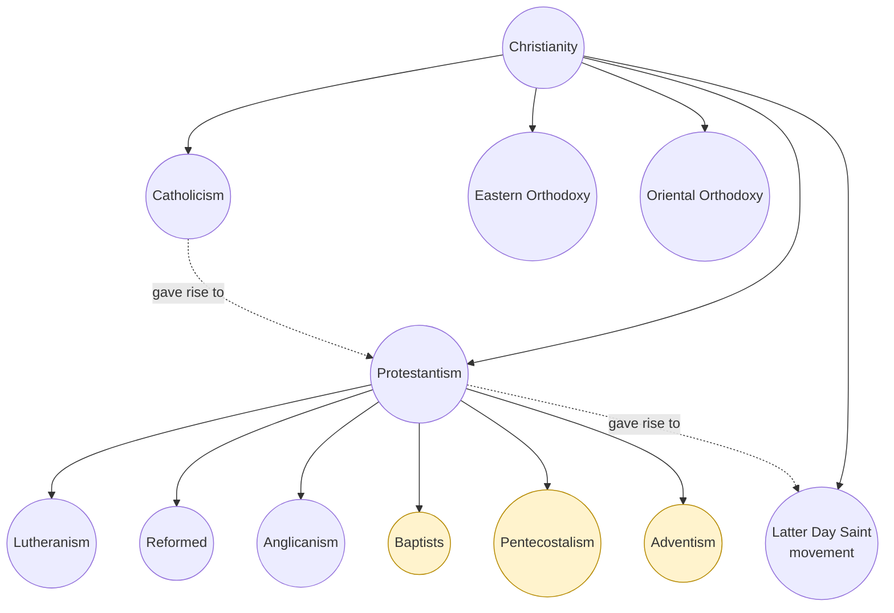
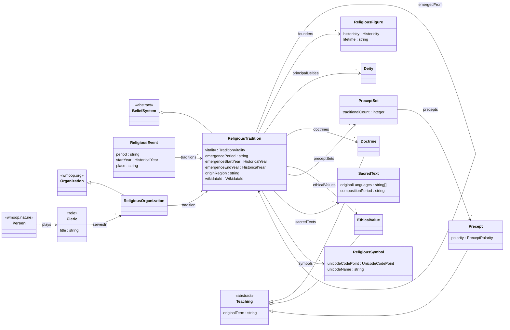

# `wmoop.religion` — Religion
### Domain design document

| | |
|---|---|
| **Module** | `wmoop.religion` |
| **Version proposed** | 0.1.0 |
| **Status** | Proposed — the worked example of [Contributing a Domain](../../08-contributing-a-domain.md) |
| **Cluster** | culture |
| **Depends on** | `wmoop.core` ^1.0.0 · `wmoop.nature` ^0.7.0 · `wmoop.org` ^0.1.0 |
| **Steward(s)** | `<student name>` (Faculty of Theology, `<university>`) · `<supervisor name>` (History of Religions) |
| **Issue** | [the domain proposal](ISSUE.md) |
| **Model** | [`model/religion/religion.wml.yaml`](../../../model/religion/religion.wml.yaml) |
| **Last updated** | 2026-11-03 |

---

## 1. Abstract

<!-- Verbatim from ABSTRACT.md. -->
Religious traditions shape the beliefs, ethics, calendars and institutions of most of humanity, yet
they resist object-oriented modelling: the familiar division into monotheistic and polytheistic
religions breaks on Hinduism, Buddhism and Jainism, branches such as Baptists or Sunni Islam are
parts of larger traditions rather than subtypes, and almost every classification is contested by
someone. `wmoop.religion` models religions as belief systems whose claims are attributed, never
asserted. A shallow identity tree, `BeliefSystem → ReligiousTradition`, carries every tradition as a
reference individual; branches are linked by a part-whole `parentTradition` and historical
derivation by `emergedFrom`; theism type, religious family and regional groupings such as the
Romanian "neo-Protestant" are first-class classification schemes holding sourced, sometimes
competing claims. Deities (as conceptions), founders and prophets (with their historicity stated),
doctrines, values, precepts, sacred texts, symbols and events are concepts of their own, and
religious organizations such as the Romanian Orthodox Church are kept apart from the traditions they
belong to. Version 0.1.0 has 13 concepts, one role, four schemes and 113 reference individuals,
among them 33 traditions in six families. It leaves out personal religious affiliation, which is a
protected attribute, and defers demographics, rituals, festivals and mythology to later sub-domains.

## 2. Motivation and use cases

Religion is one of the subjects people most often ask machines about, and one where a careless
model does the most harm: it can assert a creed as fact, erase a minority view, or label people.
WMOOP's invariants — sourced claims, schemes instead of forced trees, roles instead of protected
attributes — are exactly what the subject needs, so the domain is both useful and a demanding test
of the meta-model.

- **Teaching comparative religion and OOP together.** A course compares traditions through the same
  properties (Smart's dimensions) and, in the same exercise, learns why `Baptist extends Protestant`
  is a design error ([`04-academic.md`](../../04-academic.md), ladder A3–A5).
- **Grounding software and AI in attributed facts.** A calendar app, a museum catalogue or an AI
  assistant can answer *"what does Sikhism teach about God?"* with an attributed, sourced claim and
  the tradition's own terms, instead of an unattributed sentence.
- **Integrating datasets.** Every tradition, figure, deity, text and symbol, and most events, carry
  their Wikidata identifier (83 in all, each checked against Wikidata on 2026-11-03), so WMOOP data
  joins Wikidata, library catalogues and census tables without guessing.

## 3. Scope

**In scope.**
- Religious traditions and their branches, as L2 individuals of `ReligiousTradition`.
- What traditions hold, attributed: deities as conceptions, doctrines, ethical values, precepts and
  precept sets.
- Founders, prophets, teachers and reformers as `ReligiousFigure`s, with historicity stated.
- Sacred texts, symbols, key historical events.
- Religious organizations and their legal status in a jurisdiction (Romania first).
- The office of clergy, as a role a person plays.

**Out of scope.**
- **The religion of any person.** A protected attribute; never modelled
  ([`ETHICS.md` §3.1](../../../ETHICS.md), [`CONTRIBUTING.md` §12](../../../CONTRIBUTING.md)).
- **Truth claims** about deities, doctrines or revelations; apologetics; devotional content.
- **Demographics** — later sub-domain `religion.demographics`, once individual values can carry an
  `asOf` date ([`CONTRIBUTING.md` §7.5](../../../CONTRIBUTING.md)).
- **Practice and time** — rituals, rites of passage, festivals and liturgical calendars, later
  sub-domains `religion.practice` and `religion.calendar`.
- **Mythological narratives** — the registered sub-domain `religion.mythology`.
- **Buildings** — places of worship are `wmoop.architecture/Building`s; this domain may later attach a
  role or relation to them.

**Neighbouring domains.**

| Domain | Border |
|--------|--------|
| `wmoop.org` | `ReligiousOrganization` **extends** `wmoop.org/Organization`; a church body is an organization. |
| `wmoop.nature` | The `Cleric` role is **played by** `wmoop.nature/Person`. No other link to persons. |
| `wmoop.philosophy` | Doctrines border `PhilosophicalPosition`. `BeliefSystem` may become a shared root (§12, question 1). |
| `wmoop.geography` | Origin regions are historical names in text, deliberately not links to present-day states (§9). |
| `wmoop.architecture` | Places of worship, later. |

## 4. Background

**What a religion is.** There is no agreed definition of "religion"; definitions range from belief
in spiritual beings (Tylor) to functional and family-resemblance accounts. The domain uses Ninian
Smart's descriptive approach, which characterises a tradition by seven **dimensions** — doctrinal and
philosophical, narrative and mythic, ethical and legal, ritual, experiential and emotional, social
and institutional, and material (Smart 1996). The dimensions serve as the checklist for the
properties of `ReligiousTradition` (§7): each property records one dimension, and the dimensions not
yet modelled (ritual, experiential) are named as later sub-domains.

**How religions are grouped.** Reference works group traditions in two independent ways:

- by **conception of the divine** — monotheism, polytheism, henotheism, monolatry, monism, dualism,
  pantheism, panentheism, deism, non-theism, animism (Britannica, by entry; SEP, *Pantheism*,
  *Panentheism*). These are analytic terms of scholars, not self-descriptions, and many traditions
  fit several;
- by **lineage** — Abrahamic, Indian, Iranian, East Asian, indigenous and ethnic, new religious
  movements (Britannica, *classification of religions*). Masuzawa (2005) shows that the
  "world religions" list behind this grouping is a 19th-century European construction; the domain
  keeps the grouping because readers use it, and labels it as common usage.

**Romanian usage.** Romania grants the status of recognised religious denomination (*cult*) under
Law no. 489/2006, which also provides for religious associations and religious groups. The law's
annex listed the 18 denominations recognised when it came into force; a nineteenth, the Assemblies
of God in Romania, was recognised by Government Decision no. 741/2024, so legal status is a dated
claim. Romanian scholarship (Modoran 2007) and everyday usage group the Adventist, Baptist, Brethren
(*Creștini după Evanghelie*) and Pentecostal churches as **neo-Protestant**. No official list uses
the grouping — the State Secretariat for Religious Affairs and the 2021 census name each
denomination on its own — and the name itself is debated, *evangelical* being increasingly
preferred (Acta Marisiensis 2022). In the 2021 census, Pentecostals (404,475 people, 2.1 % of the
population) and Baptists (103,213, 0.5 %) were the largest of these churches (INS 2023, table 2.4.1).
Both the legal status and the grouping are modelled as schemes (§8).

**Transliteration.** Sanskrit and Pali follow IAST, Arabic, Hebrew and Persian follow ALA-LC, Chinese
follows Hanyu Pinyin. The `id` and `name` stay ASCII; labels keep diacritics and native script.

## 5. Analysis — from the first sketch to the model

The domain started from a theology student's sketch ([issue appendix](ISSUE.md#appendix--the-first-draft-and-what-review-changed)):

```
Religion
├── Monotheistic
│   ├── Christianity ── Protestants, neo-Protestants, Baptists, Mormons, …
│   ├── Islam ── Sunnis, Shias
│   ├── Hinduism
│   ├── Buddhism
│   └── Judaism
└── Polytheistic
common properties: values, name of God / gods, laws and commandments, founding year,
                   doctrine, country, founder, main events, logo
```

The subject and the property list are sound — nearly every property survives, renamed. The
structure changes for the reasons below.

### 5.1 *Monotheistic* and *polytheistic* are classifications, not parent classes

An `extends` edge must hold for every member, always and without caveat
([`CONTRIBUTING.md` §6.2](../../../CONTRIBUTING.md#62-liskov-checklist-for-every-extends)). Here it
does not:

- **Hinduism** is described as polytheistic, henotheistic (the term was coined for Vedic religion),
  monotheistic in its devotional strands, and monist in Advaita Vedānta (Britannica, *Hinduism*,
  *henotheism*, *Advaita*).
- **Buddhism** and **Jainism** know gods but no creator on whom liberation depends; reference works
  call them non-theistic (Britannica, *Buddhism*, *Jainism*).
- **Zoroastrianism** is read as monotheist or as dualist, depending on the scholar.
- Classification changes over time: scholars reconstruct pre-exilic Israelite religion as monolatrous
  before it became monotheistic (Smith 2002).

So theism type is a **scheme**, `TheismTypology`, and each tradition carries one claim per sourced
view, with `rank`, `status` and `asOf` where they apply (ADR 0001;
[`ETHICS.md` §2.5](../../../ETHICS.md)). Hinduism carries four claims of equal rank; Judaism carries
a preferred *monotheism* claim and a historical *monolatry* claim dated to the period before the exile.

### 5.2 Traditions are individuals, not classes

Christianity, Islam, Protestantism and the Baptist tradition have the same **kinds** of facts — a
period of emergence, a region, texts, symbols, branches — with different **values**. A class per
tradition adds no property and no behaviour: `class Baptist extends Protestant extends Christianity`
is a subclass explosion that would also break the depth cap (≤ 6) and Liskov on the first contested
case. Each tradition is therefore an **L2 individual** of one concept, `ReligiousTradition`, exactly
as each planet is an individual of `Planet`. The generated code exposes them as static instances —
`ReligiousTradition.BaptistTradition` — with typed references between them.

### 5.3 A branch is part of its parent

*"Baptists are Protestants"* means that the Baptist tradition is a **branch within** Protestantism,
which is a branch within Christianity — a part-whole statement between individuals, not inheritance
between classes. `parentTradition` records it (0..1). A second link, `emergedFrom` (0..*), records
**historical derivation without membership**: Christianity emerged from Second Temple Judaism without
being part of Judaism; the Bahá'í Faith emerged from the Bábí movement in Shia Islam, but Bahá'ís
regard it as an independent religion and Muslims do not count it as part of Islam
(Britannica, *Bahāʾī Faith*). Keeping the two links apart is what lets the model say both things
without contradiction.

`parentTradition` is a property rather than a `part_of` relation because L2 individuals carry
property values only; the definition states its part-whole meaning.

### 5.4 Levels, gaps and one misplacement

The sketch put *Protestants*, *neo-Protestants*, *Baptists* and *Mormons* side by side. They sit at
different levels, one of them is not a level at all, and three branches are missing:



*Solid arrows: `parentTradition`, read upward (the lower tradition is a branch of the upper one).
Dotted: `emergedFrom`, read backward (the target emerged from the source). Highlighted: classified* `NeoProtestant` *under `RomanianConfessionalGroups`.*

- **Missing:** Catholicism, Eastern Orthodoxy — the tradition of the Romanian Orthodox Church — and
  Oriental Orthodoxy, which separated after the Council of Chalcedon (451).
- **Misplaced:** the Latter Day Saint movement is not Protestant; it teaches a *restoration*, not a
  reformation. Its place under Christianity follows its self-understanding and common
  religious-studies usage; the Catholic Church, the Orthodox churches and many Protestant churches
  regard it as outside historic Christianity because it rejects the Nicene doctrine of the Trinity.
  The individual records both views. Its preferred name is The Church of Jesus Christ of Latter-day
  Saints; *Mormon* is an alternate label.
- **Contested placements kept visible:** Anglicanism under Protestantism (many Anglicans call their
  church both Catholic and Reformed); Vajrayāna as a branch of Buddhism rather than of Mahāyāna.

### 5.5 *Neo-Protestant* is a regional scheme

Romanian scholarship and usage group the Adventist, Baptist, Brethren and Pentecostal churches as
neo-Protestant (Modoran 2007); English-language scholarship groups the same churches as Evangelical
or Free Church Protestantism, no Romanian official list uses the grouping, and Romanian historians
themselves debate the name. A class `NeoProtestant` would impose one country's vocabulary — and one
side of that debate — on everyone; a scheme `RomanianConfessionalGroups` (consensus: common usage)
records the grouping where it is used, next to the default tree
([`ETHICS.md` §3.6](../../../ETHICS.md)).

### 5.6 Founding year, founder and country

- **Year → emergence period.** Most traditions took shape over a period, and several reject the idea
  of a beginning (Hinduism as *sanātana dharma*; Jainism's eternal teaching). The model stores
  `emergencePeriod` in words that keep the uncertainty, plus `emergenceStartYear` and
  `emergenceEndYear` (ISO 8601 astronomical numbering) for sorting.
- **Founder → an attribution.** `founders` lists the figures *regarded as* founders, with the
  attribution in the provenance note. Islam sees Muhammad as the final prophet of the original
  religion, not as a founder; Luther meant to reform the Western Church, not to found one. Every
  `ReligiousFigure` states its `historicity` — `HISTORICAL_CONSENSUS` (the Buddha, Muhammad, Guru
  Nanak, and Zarathustra, whose existence is accepted though his dates are not), `DEBATED` (Moses,
  Laozi) or `TRADITION_ONLY` (Abraham) — because the tradition's account and the historian's are
  different claims.
- **Country → historical region.** *Judaea and Galilee, Roman Empire*; *Hejaz, Arabian Peninsula*;
  *Punjab region*. Mapping them to present-day states would be anachronistic and, for some, take a
  side in a dispute ([`ETHICS.md` §3.2](../../../ETHICS.md)).

### 5.7 "The name of God" is a conception with many names

One string per tradition cannot hold *YHWH* and its substitutes *Adonai* and *HaShem*, the Arabic
*Allāh* (used also by Arabic-speaking Christians and Jews), the Trinity of trinitarian Christianity,
or the many deities of a polytheistic tradition. `Deity` is a concept whose individuals are
**conceptions**: names live in `labels`, per language and script; the tradition links its
`principalDeities`. Whether different traditions worship the same God is a theological question the
model does not settle — the `Allah` individual cites one position (*Nostra aetate* §3) as a position.

### 5.8 Symbols, not logos

Traditions have **symbols**; an organization may have an emblem, which can be a registered trademark.
`ReligiousSymbol` stores the Unicode code point and character name (U+271D LATIN CROSS, U+1FAAF
KHANDA, which since Unicode 15.0 replaces the older stand-in U+262C ADI SHAKTI), and these carry no
image licence. The notes record that the star and
crescent is not accepted by all Muslims as a religious symbol and that the Star of David is also a
national emblem.

### 5.9 A tradition is not a church

*Eastern Orthodoxy* (a tradition) and *the Romanian Orthodox Church* (an organization of that
tradition) answer different questions: only the organization has a legal name, a legal status, a
seat and dates of autocephaly. `ReligiousOrganization` extends `wmoop.org/Organization` and points to
its `tradition`; Romanian legal status is a scheme on the organization, never on the tradition.

## 6. The model



| Node | WML kind | L0 category | Stereotype | Purpose |
|------|----------|-------------|------------|---------|
| `BeliefSystem` | concept (abstract) | Abstract | Kind | Identity root for religions and, later, other belief systems ([`ETHICS.md` §3.3](../../../ETHICS.md)). |
| `ReligiousTradition` | concept | Abstract (social) | Subkind | Every tradition and branch, as L2 individuals. |
| `Deity` | concept | Abstract | Kind | A tradition's conception of a divine being. |
| `ReligiousFigure` | concept | Abstract (a figure as presented) | Kind | Founders, prophets, reformers, with historicity. |
| `Teaching` | concept (abstract) | Abstract | Kind | What a tradition teaches, attributed. |
| `Doctrine` · `EthicalValue` · `Precept` | concepts | Abstract | Subkinds | What is held true · what is held good · what is required or forbidden. |
| `PreceptSet` | concept | Abstract | Collection | A named list of precepts (commandments, pillars). |
| `SacredText` | concept | Abstract (the work) | Kind | Scriptures and authoritative texts. |
| `ReligiousSymbol` | concept | Abstract (the sign) | Kind | Signs that stand for a tradition. |
| `ReligiousEvent` | concept | Perdurant | EventType | Councils, schisms, migrations, revivals. |
| `ReligiousOrganization` | concept | Endurant (social) | Subkind of `wmoop.org/Organization` | Church bodies, unions, federations. |
| `Cleric` | role | Role | Role on `wmoop.nature/Person` | The office of clergy; never a belief. |
| `HistoricalYear` · `UnicodeCodePoint` · `WikidataId` | datatypes | — | — | Refined primitives with constraints. |
| `TraditionVitality` · `Historicity` · `PreceptPolarity` | enumerations | — | Enumeration | Closed value sets. |
| `TheismTypology` · `ReligiousFamilies` · `RomanianLegalStatus` · `RomanianConfessionalGroups` | schemes | — | Scheme (ADR 0001) | Contested and perspectival groupings. |

The `extends` spine has depth 2 everywhere (`BeliefSystem → ReligiousTradition`,
`Teaching → Precept`, `Organization → ReligiousOrganization`).

**Reference individuals (L2).**

| Concept | Count | Chosen how |
|---------|------:|------------|
| `ReligiousTradition` | 33 | every tradition named in the student's sketch, the missing Christian branches, the major branches of Islam, Judaism and Buddhism, and one or two traditions per remaining family, including one historical polytheism |
| `ReligiousFigure` | 15 | the founders those traditions name, one per historicity value at least |
| `SacredText` | 11 | the principal scripture of each top-level tradition |
| `ReligiousSymbol` | 9 | the symbols with a Unicode character |
| `Deity` | 8 | the principal deities of the top-level traditions, and Zeus for polytheism |
| `Doctrine` · `EthicalValue` | 5 · 5 | one or two central teachings per family |
| `Precept` · `PreceptSet` | 10 · 3 | the Five Precepts (prohibitions) and the Five Pillars (obligations) in full; the Ten Commandments as a set |
| `ReligiousEvent` | 9 | the events behind the branch points of the lineage tree |
| `ReligiousOrganization` | 5 | the Romanian recognised denominations of the traditions in the example, among them the nineteenth, recognised in 2024 |

## 7. Property catalogue

The **Dimension** column maps each property to Smart's dimensions (§4); the student's original
property is in the last column.

| Property | Type | Card. | Meaning | Dimension | Sketch said |
|----------|------|-------|---------|-----------|-------------|
| `ReligiousTradition#vitality` | `TraditionVitality` | 1 | living, historical or revived | social | — (added) |
| `#emergencePeriod` | string | 0..1 | when it emerged, with uncertainty | narrative / historical | founding year |
| `#emergenceStartYear` · `#emergenceEndYear` | `HistoricalYear` | 0..1 | the same, as sortable years | — | founding year |
| `#originRegion` | string | 0..1 | historical region of emergence | — | country |
| `#parentTradition` | `ReligiousTradition` | 0..1 | the tradition it is a branch of | social | (the tree) |
| `#emergedFrom` | `ReligiousTradition` | 0..* | traditions it arose from, without membership | narrative / historical | — (added) |
| `#founders` | `ReligiousFigure` | 0..* | figures regarded as founders | narrative | founder |
| `#principalDeities` | `Deity` | 0..* | divine beings at the centre of worship | doctrinal | name of God / gods |
| `#doctrines` | `Doctrine` | 0..* | central doctrines | doctrinal | doctrine |
| `#ethicalValues` | `EthicalValue` | 0..* | qualities of character taught as good | ethical | values |
| `#preceptSets` | `PreceptSet` | 0..* | commandments, pillars, vows | ethical / legal | laws, commandments |
| `#sacredTexts` | `SacredText` | 0..* | scripture | narrative / doctrinal | — (added) |
| `#symbols` | `ReligiousSymbol` | 0..* | signs that stand for it | material | logo |
| `#wikidataId` | `WikidataId` | 0..1 | cross-reference | — | — (added) |
| `ReligiousEvent#…` | | | period, years, place, traditions | narrative / historical | main events |
| `Precept#polarity` | `PreceptPolarity` | 1 | obligation, recommendation, discouragement, prohibition | ethical | what is good / not good to do |
| `ReligiousFigure#historicity` | `Historicity` | 1 | state of historical scholarship | — | — (added) |
| `ReligiousOrganization#tradition` | `ReligiousTradition` | 1 | the tradition of a church body | social / institutional | — (added) |

Every list-valued property is `completeness: open`: an empty list means *not recorded yet*, never
*none* ([`02-meta-model.md`](../../02-meta-model.md), open-world facts).

**Added after research**, each for a stated reason: sacred texts (Smart's narrative and doctrinal
dimensions; the first thing reference works list); vitality (historical religions such as ancient
Greek religion are a large part of the subject); historicity of figures (the tradition's account and
the historian's are different claims); emergence *from* (derivation is not membership); organizations
(legal status belongs to a body, not to a tradition); Wikidata identifiers (interoperability).

## 8. Classification schemes

| Scheme | Classifies | Authority / consensus | Values |
|--------|-----------|-----------------------|--------|
| `TheismTypology` | traditions | comparative religion · scholarly majority | Monotheism, Polytheism, Henotheism, Monolatry, Monism, Dualism, Pantheism, Panentheism, Deism, Nontheism, Animism |
| `ReligiousFamilies` | traditions | reference works · common usage (critique: Masuzawa 2005) | Abrahamic, Indian, Iranian, EastAsian, IndigenousAndEthnic, NewReligiousMovement |
| `RomanianLegalStatus` | organizations | Romanian State, Law no. 489/2006 | RecognisedDenomination, ReligiousAssociation, ReligiousGroup |
| `RomanianConfessionalGroups` | traditions | Romanian usage · common usage | Orthodox, Catholic, Protestant, NeoProtestant |

Example claims, taken from the model:

```yaml
# Hinduism: four claims of equal rank — no single answer
classified_as:
  - { scheme: wmoop.religion/TheismTypology, value: Polytheism, rank: normal, tier: B, provenance: [ … 'Hinduism' ] }
  - { scheme: wmoop.religion/TheismTypology, value: Henotheism, rank: normal, tier: B, provenance: [ … 'henotheism' ] }
  - { scheme: wmoop.religion/TheismTypology, value: Monotheism, rank: normal, tier: B, provenance: [ … devotional strands ] }
  - { scheme: wmoop.religion/TheismTypology, value: Monism,     rank: normal, tier: B, provenance: [ … 'Advaita' ] }

# Judaism: a current claim and a dated, historical one
  - { scheme: wmoop.religion/TheismTypology, value: Monotheism, rank: preferred, … }
  - { scheme: wmoop.religion/TheismTypology, value: Monolatry, rank: normal, status: historical,
      asOf: "Israelite religion before the Babylonian exile (6th century BCE)", provenance: [ Smith 2002 ] }

# The Baptist tradition: the Romanian grouping, next to the default tree
  - { scheme: wmoop.religion/RomanianConfessionalGroups, value: NeoProtestant, rank: preferred }
```

**Default projection.** ADR 0001 (decision 4) asks each domain for one default tree, chosen by a
sourced decision. This domain's default is the `parentTradition` tree of descriptive religious
studies, which places a tradition where reference works and its own self-understanding place it; the
rival placements are recorded in the notes (§5.4). Whether that choice needs its own ADR is open
question 2 (§12).

## 9. Ethics and neutrality

| Checklist line ([Contributing a Domain §5](../../08-contributing-a-domain.md#5-sensitive-subjects--the-checklist)) | How the model complies |
|------|------|
| Beliefs attributed | Every `Deity`, `Teaching` and sacred-history statement is phrased as the tradition's (*"which Muslims hold to be"*, *"Islamic tradition dates"*); figures carry `historicity` separate from the tradition's account. |
| No ranking, no disparagement | No property orders traditions; definitions use each community's own terms; *sect* and English *cult* are never used. |
| Contested groupings are schemes | Theism type, families, neo-Protestant and Romanian legal status are four schemes; no grouping is a class. |
| No person classified by religion | No `Person#religion`, no `Believer` or `Adherent` role. `Cleric` records an office, and the module contains no individuals of living persons. |
| No private living person | The 15 figures are historical or traditional figures of public scholarship. |
| Disputed places | `originRegion` uses historical names (*Judaea and Galilee, Roman Empire*), not present-day states. |
| No advice | Precepts are reported in the third person (*"abstaining from taking life"*), never as imperatives. |
| Licences | Symbols are Unicode characters; no images are reused; definitions are in our own words, no translation of scripture is quoted. |

**Names.** Preferred labels are the names communities use for themselves (The Church of Jesus
Christ of Latter-day Saints; Sanātana Dharma as an alternate for Hinduism); exonyms are alternates.
The Romanian *islamism* is kept as an alternate label only, because it also names political Islamism.

## 10. Validation

```bash
python schema/validate_wml.py --strict
python tools/gen_taxonomy.py --check
```

```
WML validation - 16 file(s), 13 module(s), 97 concept(s), 9 role(s), 195 individual(s)
OK - 0 errors, 0 warning(s)
gen_taxonomy: docs/06-domain-taxonomy.md is up to date
```

The generators of `wmoop.tools` produce the module in all three languages
(`tools/check_generated.py --model …`: deterministic and valid for Python, C# and TypeScript; the C#
solution builds with no warnings).

## 11. Roadmap

| PR | Content | Nodes |
|----|---------|------:|
| 1 | module header; `BeliefSystem`, `ReligiousTradition`, `HistoricalYear`, `TraditionVitality`; taxonomy `candidate → seeded`; regenerated diagrams | 4 |
| 2 | the four schemes | 4 |
| 3 | `Deity`, `ReligiousFigure` + `Historicity`, `SacredText`, `ReligiousSymbol` (+ `UnicodeCodePoint`, `WikidataId`) | 5 |
| 4 | `Teaching`, `Doctrine`, `EthicalValue`, `Precept` (+ `PreceptPolarity`), `PreceptSet` | 5 |
| 5 | `ReligiousEvent`, `ReligiousOrganization`, the `Cleric` role | 3 |
| 6 | individuals — Christianity and its branches, with their figures, texts and symbols | data |
| 7 | individuals — Islam, Judaism, the Bahá'í Faith | data |
| 8 | individuals — the Indian, Iranian, East Asian and historical families | data |
| 9 | individuals — Romanian organizations and their legal status; events | data |

This worked example shows the whole of PRs 1–9 in one file so it can be read and validated at once;
a real contribution lands it in the steps above.

**Later sub-domains.**
- `religion.practice` — rituals, sacraments and rites of passage (Smart's ritual dimension).
- `religion.calendar` — festivals and liturgical calendars, including the Revised Julian and Julian
  computations that separate Orthodox and Western dates.
- `religion.demographics` — dated, sourced adherent estimates (needs per-value `asOf`).
- `religion.mythology` — narratives and cosmologies (registered in the taxonomy).
- The Ten Commandments' precepts, with each tradition's numbering as a scheme.

## 12. Open questions

1. **Where does `BeliefSystem` live?** (a) here, as now; (b) in `wmoop.philosophy`, which this module
   would then depend on; (c) in a new shared module. *Proposed:* (a) for 0.1.0, then (c) by issue if
   a second domain needs it.
2. **Does the default branch placement need its own ADR?** (a) the whitepaper suffices for a candidate
   domain; (b) an ADR, as ADR 0001 decision 4 reads. *Proposed:* (b) before 1.0.0.
3. **Confucianism and philosophical Daoism** — religion or philosophy? (a) add them as traditions with
   a scheme claim *religion / philosophy*; (b) wait for `BeliefSystem` to have a philosophy subkind.
   *Proposed:* (b).
4. **Shared doctrines.** `Karma` is one individual referenced by four traditions that read it
   differently. (a) keep one shared individual with per-tradition notes; (b) one individual per
   tradition. *Proposed:* (a) until a tradition-specific property is needed.

## 13. References

- *Acta Marisiensis. Seria Historia* (2022). "Modern Religious Movements on Romanian Territory: Can Evangelical Cults in Romania Historically be Seen as Neo-Protestant?", 4(1), 27–43. doi:10.2478/amsh-2022-0019.
- Harvey, P. (2000). *An Introduction to Buddhist Ethics: Foundations, Values and Issues*. Cambridge University Press.
- Hotărârea Guvernului nr. 741/2024 (Government Decision no. 741/2024), Romania — recognition of the Assemblies of God in Romania.
- Institutul Național de Statistică (2023). *Recensământul Populației și Locuințelor 2021*, definitive results, table 2.4.1 (population by religion).
- Jones, L. (ed.) (2005). *Encyclopedia of Religion*, 2nd ed., 15 vols. Macmillan Reference USA.
- Legea nr. 489/2006 privind libertatea religioasă și regimul general al cultelor (Law no. 489/2006 on religious freedom and the general regime of religious denominations), Romania.
- Masuzawa, T. (2005). *The Invention of World Religions, or, How European Universalism Was Preserved in the Language of Pluralism*. University of Chicago Press.
- Modoran, G. (2007). "Confesiunile neoprotestante din România în perioada regimului comunist: 1945–1965". *Studia Politica. Romanian Political Science Review* 7(3), 655–673.
- Pew Research Center (2025, 9 June). *How the Global Religious Landscape Changed From 2010 to 2020*.
- Second Vatican Council (1965). *Nostra aetate: Declaration on the Relation of the Church to Non-Christian Religions*.
- Smart, N. (1996). *Dimensions of the Sacred: An Anatomy of the World's Beliefs*. University of California Press.
- Smith, M. S. (2002). *The Early History of God: Yahweh and the Other Deities in Ancient Israel*, 2nd ed. Eerdmans.
- *Encyclopaedia Britannica* — entries as cited per node in the model.
- *Stanford Encyclopedia of Philosophy* — entries *Pantheism*, *Panentheism*, *Deontic Logic*.
- Wikidata — item identifiers (Tier C, cross-reference only).

Full register with tiers and identifiers: [`SOURCES.yaml`](SOURCES.yaml).
